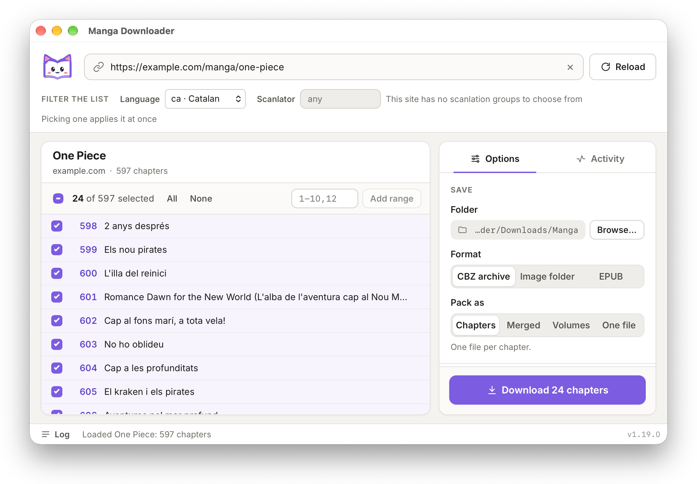
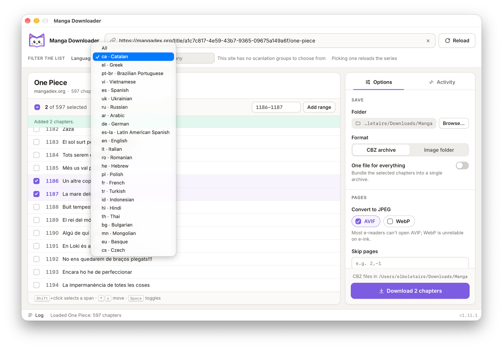
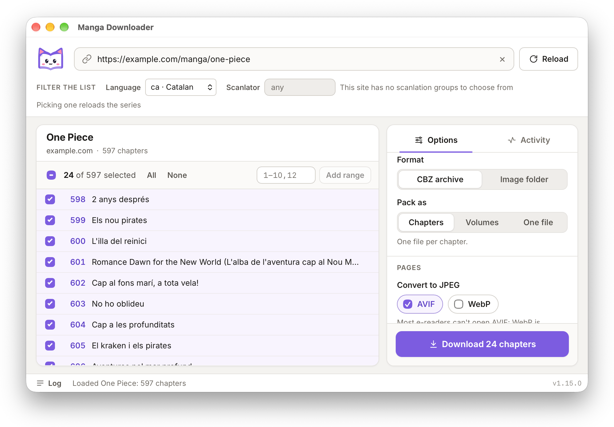
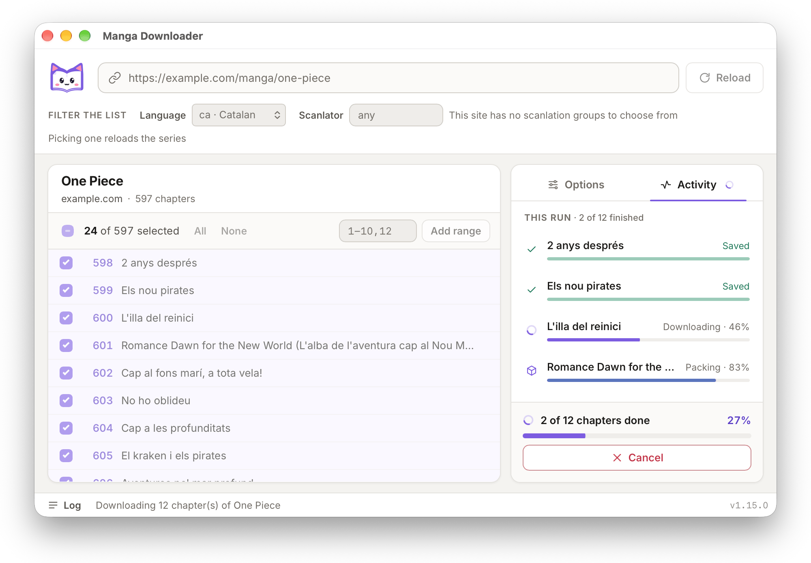
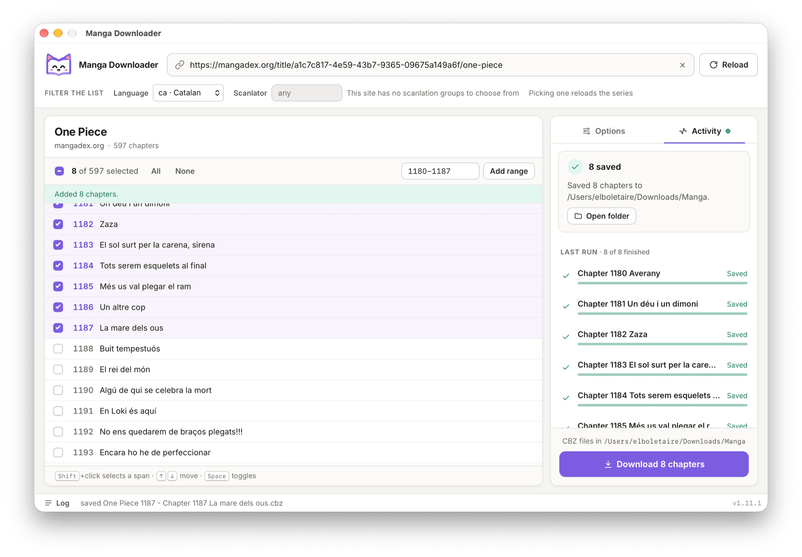

<picture>
  <source media="(prefers-color-scheme: dark)" srcset="assets/brand/readme/readme-header-dark.svg">
  
</picture>

[![Tests][tests badge]][tests]
[![Go Reference][go reference badge]][go reference]
[![GitHub release][release badge]][releases]
[![GitHub downloads][downloads badge]][releases]
[![Docker Pulls][pulls badge]][docker hub]
[![License][license badge]][license]

⭐ If you like this project, star it on GitHub!

[Features](#features) • [Installation](#installation) • [Desktop app](#using-the-desktop-app) • [Command line](#using-the-command-line) • [Supported sites](#supported-sites) • [Troubleshooting](#troubleshooting)

Manga Downloader downloads manga chapters from MangaDex and more than 80 other
sites and packs them into CBZ files, ready to read on your e-reader or in your
favorite comic app. It comes as a **desktop app** for Windows, macOS and Linux,
and as a **command line tool** for scripts, servers and Docker.

<picture>
  <source media="(prefers-color-scheme: dark)" srcset="assets/screenshots/02-loaded-dark.png">
  
</picture>

## Features

**Desktop app**

- **Paste a URL and it loads**: the series, its chapters and the languages and
  scanlation groups it offers appear on their own.
- **Pick what you need**: type a range such as `1-10,12`, Shift+click a span,
  or select all, then choose the language and scanlation group the series has.
- **Live progress**: every chapter shows up as it's fetched and packed, with a
  summary and an *Open folder* button when it's done.
- **Native folder picker**, and a window that follows your system's light or
  dark theme.

**Desktop app and command line**

- **[86 supported sites](#supported-sites)**, from big aggregators to small
  scanlation groups.
- **Chapter ranges** such as `1,3,5-10`, so you download only what's missing.
- **E-reader friendly output**: AVIF and WebP pages are converted to JPEG, so
  they don't show up blank on Kobo, KOReader or Calibre.
- **Flexible output**: one CBZ per chapter, a single bundled CBZ (`--bundle`),
  or plain image folders (`--format raw`), named from a template.
- **Language and scanlation group filters** for sites that host several versions
  of a chapter, and **skipping pages** such as credits or ads.
- **Concurrent downloads** with retries.
- **JavaScript and Cloudflare-protected sites** are handled by driving a local
  Chromium browser, which clicks "Verify you are human" checkboxes for you.

**Command line**

- **A single binary** with no runtime, no dependencies and no config file, plus
  Docker images.

## Installation

### Desktop app

Download the `manga-downloader-gui` asset for your system from the
[releases page][releases]:

- **Windows**: `manga-downloader-gui-<tag>-windows-amd64.zip`, or
  `-windows-arm64.zip` for ARM devices such as Snapdragon laptops. Unzip it and
  run `manga-downloader-gui.exe`.
- **macOS**: `manga-downloader-gui-<tag>-darwin-universal.zip`. Unzip it and move
  `Manga Downloader.app` wherever you like. Or install it with
  [Homebrew][homebrew], which also puts `manga-downloader-gui` on your `PATH`:

  ~~~bash
  brew install --cask elboletaire/tap/manga-downloader
  ~~~

  The cask installs the [command line tool](#homebrew) too, so
  `manga-downloader ui` works. Mind the `--cask`: without it, Homebrew installs
  only the command line tool, which shares the name.

- **Linux**: `manga-downloader-gui-<tag>-linux-amd64.tar.gz`, or
  `-linux-arm64.tar.gz`. Extract it and run `manga-downloader-gui`. It needs
  WebKitGTK 4.1 (`libwebkit2gtk-4.1-0` on Debian and Ubuntu), which most desktops
  already have.

> [!NOTE]
> **macOS** doesn't sign the app, so Gatekeeper blocks its first launch. Allow it
> under *System Settings → Privacy & Security* with **Open Anyway**. You only
> need to do this once.
>
> **Windows** needs the Microsoft Edge WebView2 runtime. Windows 11 and current
> Windows 10 already have it; without it, the app offers to download and install it on first launch.
> If SmartScreen shows *"Windows protected your PC"*, click **More info** →
> **Run anyway**: the file is only flagged because it isn't signed.

If the desktop app sits next to the command line tool or is on your `PATH` (the
Homebrew cask puts it there), `manga-downloader ui` opens it. On Windows,
double-clicking `manga-downloader.exe` does the same.

### Command line

#### Homebrew

On macOS and Linux, install the command line tool from [Homebrew][homebrew]:

~~~bash
brew install elboletaire/tap/manga-downloader
~~~

Homebrew doesn't quarantine the command line tool, so there's no Gatekeeper
step on macOS. `brew upgrade manga-downloader` updates it.

This installs only the command line tool. On macOS, the
[desktop app](#desktop-app) is a cask with the same name, which installs both
and gets `manga-downloader ui` working:

~~~bash
brew install --cask elboletaire/tap/manga-downloader
~~~

#### Prebuilt binary

Download the archive for your system from the [releases page][releases], extract
it and run the binary:

~~~bash
./manga-downloader --help
~~~

Builds are published for Linux, macOS and Windows on amd64 and arm64 (Windows
arm64 included), plus 32-bit builds for Linux and Windows. The Windows 32-bit
build is named `windows-32bit-legacy`.

To run it from any folder, move the binary to a folder in your `PATH`, such as
`/usr/local/bin` on Linux and macOS.

<b>Windows</b>: step-by-step setup

 

> [!IMPORTANT]
> Manga Downloader is a command line tool, so run it from a terminal, as shown
> below. Double-clicking `manga-downloader.exe` opens the desktop app when the
> app is next to it or on your `PATH`. Without it, the window only shows the help
> and waits for Enter.

1. Open **PowerShell**: press the Start button, type `PowerShell` and press
   <kbd>Enter</kbd>.
2. Paste this line and press <kbd>Enter</kbd>:

   ~~~powershell
   irm https://raw.githubusercontent.com/elboletaire/manga-downloader/master/install.ps1 | iex
   ~~~

3. Close the terminal and open a new one. Then run it from any folder:

   ~~~cmd
   manga-downloader https://mangadex.org/title/a1c7c817-4e59-43b7-9365-09675a149a6f/one-piece 1-10
   ~~~

The [install script](./install.ps1) downloads the latest release to
`%LOCALAPPDATA%\Programs\manga-downloader` and adds that folder to your `PATH`.
It doesn't need administrator rights. Run the same line again to update, and
delete that folder to uninstall.

> [!TIP]
> Files are saved in the folder the terminal is in. To download straight into
> a folder, open it in File Explorer, type `cmd` in the address bar and press
> <kbd>Enter</kbd>. A terminal opens there, ready to use.

Prefer not to run a script?

 

Download the `windows-amd64` zip from the [releases page][releases] (or
`windows-arm64` if you have an ARM device, such as a Snapdragon laptop), extract
it, and copy `manga-downloader.exe` to `C:\Windows\System32`. Windows asks for
administrator permission. After that, `manga-downloader` works in any terminal.

> [!WARNING]
> This works, but it isn't the best place for the program: it needs
> administrator rights and mixes it with Windows' own files. To update or
> uninstall it, you have to go back to that folder and replace or delete the
> file yourself.

If Windows SmartScreen shows *"Windows protected your PC"*, the binary is only
flagged because it isn't signed. Click **More info** → **Run anyway**.

<b>macOS</b>: allowing an unsigned binary

 

The binary isn't signed, so Gatekeeper blocks it the first time you run it:

1. Run `./manga-downloader` once and dismiss the warning.
2. Open **System Settings** → **Privacy & Security**, scroll down to
   **Security**, and click **Open Anyway** next to the *manga-downloader*
   message.
3. Run `./manga-downloader` again and confirm the dialog.

You only need to do this once.

#### Docker

~~~bash
docker run --rm -it -v "$PWD:/downloads" elboletaire/manga-downloader [url] [chapters]
~~~

Files are written to the mounted `/downloads` folder. They're owned by
`USER_ID`/`GROUP_ID`, which both default to `1000`. If your user has a
different ID, pass it with
`-e USER_ID=$(id -u) -e GROUP_ID=$(id -g)`.

The default image has no browser. For sites marked with `*`, use the `:browser`
image, which ships Chromium and a virtual display:

~~~bash
docker run --rm -it -v "$PWD:/downloads" elboletaire/manga-downloader:browser [url] [chapters]
~~~

Showing the browser window on your own display

 

The `:browser` image passes Cloudflare challenges on its own. If a challenge
needs a real person, forward the window to your Linux desktop. You may need to
run `xhost +local:` first:

~~~bash
docker run --rm -it -e DISPLAY=$DISPLAY -v /tmp/.X11-unix:/tmp/.X11-unix \
    -v "$PWD:/downloads" elboletaire/manga-downloader:browser --browser-visible [url] [chapters]
~~~

#### Go

~~~bash
go install github.com/elboletaire/manga-downloader@latest
~~~

> [!TIP]
> Binaries installed this way don't report a version number, because the
> version is only added to release builds.

## Using the desktop app

Open the app and follow these steps:

1. **Paste the series' URL** into the box at the top. The app loads the series
   on its own, without a button.
2. **Pick chapters** in the list. Type a range such as `1-10,12` and press
   *Add range*, Shift+click to select a span, or use *All* and *None*. The
   arrow keys and Space work too.
3. **Choose a language and a scanlation group** when the site offers them. The
   selectors only appear for series that list them, and picking one reloads the
   chapter list. Sites that support it also offer *All*.

   <picture>
     <source media="(prefers-color-scheme: dark)" srcset="assets/screenshots/03-language-selector-dark.png">
     
   </picture>

4. **Set the options** in the *Options* tab: where the files go, the format
   (CBZ archive or image folder), *One file for everything* to bundle the
   chapters, *Convert to JPEG* for AVIF and WebP pages, pages to skip, the file
   name template, and whether to *Show the browser window*.

   <picture>
     <source media="(prefers-color-scheme: dark)" srcset="assets/screenshots/06-options-dark.png">
     
   </picture>

5. **Press Download.** The *Activity* tab shows each chapter as it's fetched and
   packed. *Cancel* lets the chapters already downloading finish, and starts no
   new ones. A log is one click away in the status bar.

   <picture>
     <source media="(prefers-color-scheme: dark)" srcset="assets/screenshots/04-downloading-dark.png">
     
   </picture>

6. **When it's done**, the summary shows what was downloaded. Press
   *Open folder* to go straight to the files.

   <picture>
     <source media="(prefers-color-scheme: dark)" srcset="assets/screenshots/05-done-dark.png">
     
   </picture>

The app saves your options to `gui.json` in the `manga-downloader` folder of
your user config folder (the same place as the Manga Plus secret, see
[below](#environment-variables)), so they're still there the next time you open
it. Files go to your Downloads folder (or your home folder, if there isn't one)
unless you choose another folder.

The app uses the command line's defaults for concurrency and retries.

## Using the command line

~~~bash
manga-downloader [flags] [url] [chapters]
~~~

- `url` is the manga's **index page**, the page that lists all its chapters.
  Don't use the URL of a single chapter.
- `chapters` is a comma-separated list of numbers and ranges, such as
  `1,3,5-10`. If you leave it out, the tool asks whether to download every
  chapter. The answer defaults to "no".

Arguments aren't positional, so `manga-downloader 1-50 [url]` works too.

![prompt img]

![download img]

### Language and scanlation group

Some sites, such as MangaDex, list each chapter once per language. Use
`--language` to download only one of them:

~~~bash
manga-downloader --language es https://mangadex.org/title/a1c7c817-4e59-43b7-9365-09675a149a6f/one-piece 1-10
~~~

On sites that list several languages, `--language all` downloads every one of them.

Sites that host several scanlation groups' versions of the same chapter download
the group with the most chapters, and list the other groups. Use
`--scanlator <name>` to pick a group, or `--scanlator all` to download every
version. With `all`, the group name is added to each file name.

### Bundling and output format

~~~bash
# all chapters in a single CBZ, one folder per chapter inside it
manga-downloader --bundle [url] 1-8

# plain image folders instead of CBZ files
manga-downloader --format raw [url] 1-8
~~~

![bundle img]

### Image conversion

Most e-readers can't display AVIF, so a chapter with AVIF pages looks empty on
the device even though the download succeeded. **AVIF pages are converted to
JPEG by default.** WebP renders fine in phone apps but is unreliable on e-ink,
so converting it is opt-in:

~~~bash
manga-downloader --convert-images avif,webp [url] 1-10   # strict e-ink setup
manga-downloader --convert-images none [url] 1-10        # keep pages untouched
~~~

JPEG, PNG and GIF pages are never re-encoded. If a page fails to convert, it's
kept as it was and a warning is shown, so the rest of the chapter isn't lost.

> [!NOTE]
> The AVIF decoder is embedded as WebAssembly, so you don't need to install any
> system library. It's slower on the 32-bit builds (`linux-386` and
> `windows-32bit-legacy`), so use `--convert-images none` there if speed
> matters.

The desktop app offers the same choice as two checkboxes, *AVIF* and *WebP*.

### Skipping pages

Scanlation groups often reserve a page or two of every chapter for their own
credits or ads. `--skip-pages` drops them, using the same range syntax as the
chapter argument, applied to each chapter's pages:

~~~bash
manga-downloader --skip-pages 2 [url] 1100-1110       # just the credits page
manga-downloader --skip-pages 2,5-7 [url] 1100-1110   # several at once
~~~

Pages count from 1, and **negative positions count backwards from the end of
the chapter**: `-1` is its last page, `-3--1` the last three. They're resolved
per chapter, so `-1` means each chapter's own last page however long it is:

~~~bash
manga-downloader --skip-pages 2,-1 [url] 1100-1110    # one at each end
~~~

The pages are dropped **before** they're downloaded, so they cost no time or
bandwidth, and a page that's broken on the site's end can't fail the chapter
around it — which is the only way to download a chapter whose page 404s.

The archive is still numbered `000`, `001`, … in order, with no holes left by
the skipped pages. A position the chapter doesn't have is ignored.

> [!TIP]
> Both `--skip-pages -1` and `--skip-pages=-1` work: the value right after the
> flag is taken verbatim, dash and all. Use the `=` form if a shell or a
> wrapper script trips on the leading dash.

### File names

Use `--filename-template` to change file names. It takes a
[Go text/template][go template] string, and the default is:

~~~
{{.Series}} {{.Number}} - {{.Title}}{{if gt .Version 1}} v{{.Version}}{{end}}
~~~

`{{.Version}}` is a counter that's added when two files would have the same
name.

### Environment variables

| Variable           | Description                                    |
| ------------------ | ---------------------------------------------- |
| `MANGAPLUS_SECRET` | Anonymous device secret to use for Manga Plus |

**Manga Plus** answers the complete chapter list only to an app client, which
authenticates with an anonymous device secret. manga-downloader registers one
on first use and caches it in `manga-downloader/mangaplus-secret` inside your
user config folder (`$XDG_CONFIG_HOME` or `~/.config` on Linux,
`~/Library/Application Support` on macOS, `%AppData%` on Windows): no account is
ever needed. Secrets are 32 lowercase hexadecimal characters, and anything that
isn't one is treated as absent — so exporting a malformed `MANGAPLUS_SECRET`,
or deleting the cached file, makes the next run register a fresh device, as
does a cached secret the API stops accepting. Export a valid
`MANGAPLUS_SECRET` to reuse a secret registered elsewhere, such as the one of a
device with your Manga Plus subscription.

In **Docker**, the cached secret lives inside the container and is lost with
it, so every run registers a new device. To keep one, either pass it with
`-e MANGAPLUS_SECRET=...`, or mount your own config folder so the container
shares the secret of your local install (create the folder first, or Docker
creates it owned by root):

~~~bash
mkdir -p ~/.config/manga-downloader
docker run --rm -it -v "$PWD:/downloads" \
    -v ~/.config/manga-downloader:/home/manga/.config/manga-downloader \
    elboletaire/manga-downloader [url] [chapters]
~~~

Manga Plus also publishes **one edition per language**, and their chapter
lists differ: some list the whole series, others only a handful of chapters.
A URL points at one edition, and `--language` downloads another one instead
(`--language en` on a Spanish URL downloads the English edition).

### Options

| Flag                  | Short | Description                                              | Default        |
| --------------------- | ----- | -------------------------------------------------------- | -------------- |
| `--output-dir`        | `-o`  | Folder to write the downloaded files to                  | current folder |
| `--bundle`            | `-b`  | Bundle all chapters into a single file                   | off            |
| `--format`            | `-f`  | Output format: `cbz` or `raw`                            | `cbz`          |
| `--filename-template` | `-t`  | Template for the file names                              | see above      |
| `--language`          | `-l`  | Only download the specified language                     | site default   |
| `--scanlator`         | `-s`  | Only download the specified scanlation group (or `all`)  | most chapters  |
| `--convert-images`    |       | Formats to convert to JPEG: `avif`, `webp` or `none`     | `avif`         |
| `--skip-pages`        |       | Pages to exclude from every chapter (`-1` is the last)   | none           |
| `--concurrency`       | `-c`  | Number of chapters downloaded at once (max 5)            | 5              |
| `--concurrency-pages` | `-C`  | Number of pages downloaded at once per chapter (max 10)  | 10             |
| `--retry`             | `-r`  | Retries per failed page (max 3, `0` disables retrying)   | 1              |
| `--browser-visible`   |       | Show the browser window from the start                   | off            |
| `--version`           | `-v`  | Show version information                                 |                |

Run `manga-downloader help` to list them in your terminal.

![help img]

## Supported sites

<b>Show all 86 supported sites</b>

 

- [asmotoon.com (Asmodeus Scans)](https://asmotoon.com)
- [asurascans.com (Asura Scans, former asuratoon.com)](https://asurascans.com)
- [atsu.moe (Atsumaru)](https://atsu.moe)
- [aurorascans.com (redirects to qimanga.com)](https://aurorascans.com)
- [bigsolo.org](https://bigsolo.org)
- [bluesolo.org (Blue Solo, French scantrad)](https://bluesolo.org)
- [comix.to](https://comix.to) \*
- [danke.moe (Danke fürs Lesen)](https://danke.moe)
- [deathtollscans.net](https://reader.deathtollscans.net)
- [demonicscans.org (MangaDemon / Demonic Scans)](https://demonicscans.org)
- [dragontea.ink](https://dragontea.ink) \*
- [drakecomic.net (Drake Scans, former drakecomic.org)](https://drakecomic.net)
- [dynasty-scans.com (Dynasty Reader)](https://dynasty-scans.com)
- [elftoon.net (Elf Toon, former elftoon.com)](https://elftoon.net)
- [en-hijala.com (Hijala Translations)](https://en-hijala.com)
- [en-thunderscans.com (Thunderscans)](https://en-thunderscans.com)
- [fanfox.net (Manga Fox)](https://fanfox.net)
- [flamecomics.xyz (Flame Comics, former Flame Scans)](https://flamecomics.xyz)
- [fmteam.fr](https://fmteam.fr)
- [furyosociety.com](https://furyosociety.com)
- [gdscans.com (GalaxyDegenScans)](https://gdscans.com)
- [genzupdates.com (Genz Toon)](https://genzupdates.com)
- [guya.moe (Guya, Kaguya-sama)](https://guya.moe)
- [hivetoons.org (HiveToons, VoidScans)](https://hivetoons.org)
- [inmanga.com](https://inmanga.com)
- [jestful.net](https://jestful.net)
- [kappabeast.com](https://kappabeast.com) \*
- [kaynscans.com (Kayn Scans, former kaynscan.org)](https://kaynscans.com)
- [lagoonscans.com](https://lagoonscans.com)
- [leercapitulo.co](https://www.leercapitulo.co) \*
- [lhtranslation.net (LHTranslation)](https://lhtranslation.net)
- [luacomic.org (LuaScans)](https://luacomic.org)
- [madarascans.org (former madarascans.com)](https://madarascans.org)
- [mangaball.com (former mangaball.net)](https://mangaball.com)
- [mangabats.com (former mangabat.com)](https://www.mangabats.com)
- [mangadenizi.net](https://www.mangadenizi.net)
- [mangadex.org (MangaDex)](https://mangadex.org)
- [mangafire.to](https://mangafire.to) \*
- [mangahere.cc (MangaHere)](https://www.mangahere.cc)
- [mangahub.io](https://mangahub.io) \*
- [mangak.io (MangaK, former mangabuddy.com)](https://mangak.io)
- [mangakakalot.gg (MangaKakalot)](https://www.mangakakalot.gg) \*
- [mangakatana.com](https://mangakatana.com)
- [mangalib.me (MangaLib)](https://mangalib.me)
- [mangalivre.to (Manga Livre, former mangalivre.tv/mangalivre.net)](https://mangalivre.to)
- [mangapark.page (MangaPark, the only live host: mangapark.to and the other mirrors are dead)](https://mangapark.page) \*
- [mangapill.com](https://mangapill.com)
- [mangaplus.shueisha.co.jp (Manga Plus, Shueisha's official reader)](https://mangaplus.shueisha.co.jp)
- [mangaread.org](https://www.mangaread.org)
- [mangasushi.org](https://mangasushi.org)
- [mangataro.org](https://mangataro.org)
- [mangtto.com (Mangitto)](https://mangtto.com)
- [manhuaplus.com](https://manhuaplus.com)
- [manhuatop.org](https://manhuatop.org) \*
- [manhuaus.com](https://manhuaus.com) \*
- [mgeko.cc](https://www.mgeko.cc)
- [mistscans.com](https://mistscans.com)
- [mkissa.to](https://mkissa.to) \*
- [natomanga.com (MangaNato, former manganato.com/manganelo.com)](https://www.natomanga.com) \*
- [projectsuki.com](https://projectsuki.com)
- [qimanga.com](https://qimanga.com)
- [rawkuma.net](https://rawkuma.net)
- [ritharscans.com](https://ritharscans.com)
- [rokaricomics.com](https://rokaricomics.com)
- [roliascan.com](https://roliascan.com)
- [sacachispa.site](https://sacachispa.site)
- [sanascans.com (Sana Scans)](https://sanascans.com)
- [setsuscans.com](https://setsuscans.com) \*
- [silentquill.net (Armageddon Scanlation)](https://silentquill.net)
- [stonescape.xyz](https://stonescape.xyz)
- [sushiscan.net](https://sushiscan.net) \*
- [taiyo.moe](https://taiyo.moe)
- [tcbonepiecechapters.com (TCB Scans, former tcbscans.com)](https://tcbonepiecechapters.com)
- [team-shadowi.com](https://www.team-shadowi.com)
- [templetoons.com (Temple Scan)](https://templetoons.com)
- [toongod.org](https://www.toongod.org) \*
- [toonily.com](https://toonily.com) \*
- [tritinia.org (Tritinia Scans)](https://tritinia.org)
- [twmanga.com (包子漫画, baozimh.com mirror)](https://www.twmanga.com)
- [utoon.us (UToon, home of reset-scans' content)](https://www.utoon.us)
- [violetscans.org](https://violetscans.org)
- [vortexscans.org](https://vortexscans.org)
- [weebcentral.com](https://weebcentral.com)
- [witchtoons.net (WitchToons, former witchscans.com)](https://witchtoons.net)
- [writerscans.com](https://writerscans.com)
- [zonatmo.org (TuMangaOnline, former zonatmo.com)](https://zonatmo.org)

> [!NOTE]
> **Sites marked with `*` need a Chromium-based browser** (Google Chrome,
> Chromium, Brave or Edge). They either render with JavaScript or sit behind a
> Cloudflare challenge. Manga Downloader launches the browser itself and only
> shows a window when a challenge needs solving. Pass `--browser-visible` to
> skip the headless attempt and show the window from the start.

Other sites built on the same platforms often work too, even when they aren't
listed. If one doesn't, [open an issue][issues] or send a pull request.

## Troubleshooting

<b>The newest chapter downloads empty or is missing</b>

 

Many sites keep their latest chapters behind a paywall, and the page often looks
normal. Try a slightly older chapter to confirm that the site works.

<b>Old chapters are missing, or a warning says the range starts before the first chapter</b>

 

Sites often delete old chapters. The tool can only download chapters that the
site still lists.

<b>A browser window pops up</b>

 

This is expected for sites marked with `*`. The window opens when the site shows
a Cloudflare challenge. Checkboxes are clicked automatically, but some challenges
need you to click them yourself. To show the window from the start, pass
`--browser-visible` or tick *Show the browser window* in the app.

<b>Pages don't show up on my e-reader</b>

 

The site probably serves WebP images. Download the chapters again with
`--convert-images avif,webp`, or tick *WebP* under *Convert to JPEG* in the app.

## Building from source

The command line tool needs Go 1.19 or newer:

~~~bash
make install   # download dependencies
make build     # test and build ./manga-downloader
~~~

The desktop app is a [Wails](https://wails.io) app: a Go program showing a
React frontend in the system's webview. It needs Go 1.26 or newer (`gui/go.mod`),
Node 22, pnpm 10, and on Linux the WebKitGTK 4.1 and GTK 3 development headers
(`libgtk-3-dev libwebkit2gtk-4.1-dev` on Debian and Ubuntu):

~~~bash
make build/gui         # build ./manga-downloader-gui (frontend first)
make build/gui/windows # cross-build manga-downloader-gui.exe, no cgo needed
~~~

## Star history

[![Star history chart][star history]][stargazers]

[downloads badge]: https://img.shields.io/github/downloads/elboletaire/manga-downloader/total
[go reference badge]: https://pkg.go.dev/badge/github.com/elboletaire/manga-downloader.svg
[release badge]: https://img.shields.io/github/release/elboletaire/manga-downloader.svg
[pulls badge]: https://img.shields.io/docker/pulls/elboletaire/manga-downloader
[license badge]: https://img.shields.io/github/license/elboletaire/manga-downloader?color=green
[tests badge]: https://github.com/elboletaire/manga-downloader/actions/workflows/test.yaml/badge.svg?branch=master
[tests]: https://github.com/elboletaire/manga-downloader/actions/workflows/test.yaml
[go reference]: https://pkg.go.dev/github.com/elboletaire/manga-downloader

[license]: ./LICENSE
[releases]: https://github.com/elboletaire/manga-downloader/releases
[homebrew]: https://brew.sh
[issues]: https://github.com/elboletaire/manga-downloader/issues
[stargazers]: https://github.com/elboletaire/manga-downloader/stargazers
[star history]: https://raw.githubusercontent.com/elboletaire/manga-downloader/star-tracker-data/charts/star-history.svg
[go template]: https://pkg.go.dev/text/template
[docker hub]: https://hub.docker.com/r/elboletaire/manga-downloader
[download img]: https://raw.githubusercontent.com/elboletaire/manga-downloader/master/demos/download.gif
[bundle img]: https://raw.githubusercontent.com/elboletaire/manga-downloader/master/demos/bundle.gif
[help img]: https://raw.githubusercontent.com/elboletaire/manga-downloader/master/demos/help.gif
[prompt img]: https://raw.githubusercontent.com/elboletaire/manga-downloader/master/demos/prompt.gif
