

<picture>
  <source media="(prefers-color-scheme: dark)" srcset="assets/brand/readme/readme-header-dark.svg">
  
</picture>

[![Tests][tests badge]][tests]
[![Go Reference][go reference badge]][go reference]
[![GitHub release][release badge]][releases]
[![GitHub downloads][downloads badge]][releases]
[![Docker Pulls][pulls badge]][docker hub]
[![License][license badge]][license]

⭐ If you like this project, star it on GitHub!

[Website][website] • [Features](#features) • [Installation](#installation) • [Desktop app](#using-the-desktop-app) • [Command line](#using-the-command-line) • [Supported sites](#supported-sites) • [Troubleshooting](#troubleshooting)

Manga Downloader downloads manga chapters from MangaDex and 200 other sites and
packs them into CBZ, CBR or EPUB files, ready to read on your e-reader or in
your favorite comic app. It comes as a **desktop app** for Windows, macOS and
Linux, and as a **command line tool** for scripts, servers and Docker.

<picture>
  <source media="(prefers-color-scheme: dark)" srcset="assets/screenshots/02-loaded-dark.webp">
  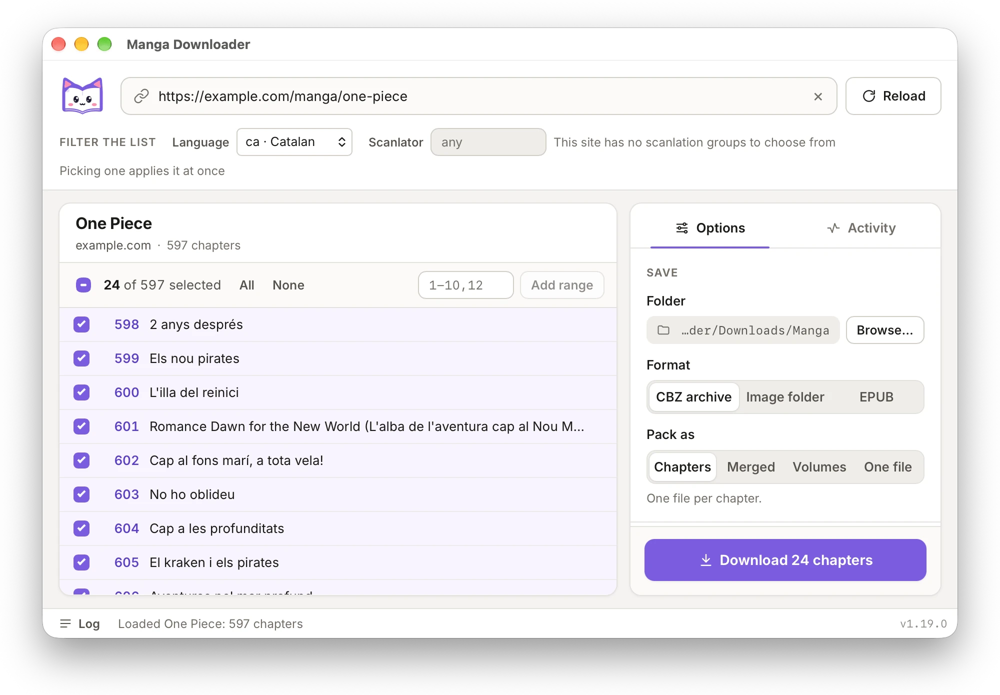
</picture>

## Features

**Desktop app**

- **Paste a URL and it loads**: the series, its chapters and the languages and
  scanlation groups it offers appear on their own.
- **Pick what you need**: type a range such as `1-10,12`, Shift+click a span,
  or select all, then choose the language and scanlation group the series has.
- **Live progress**: every chapter shows up as it's fetched and packed, with a
  summary and an *Open folder* button when it's done.
- **Native folder picker**, and a window that follows your system's light or
  dark theme.

**Desktop app and command line**

- **[201 supported sites](#supported-sites)**, from big aggregators to small
  scanlation groups.
- **Chapter ranges** such as `1,3,5-10`, so you download only what's missing.
- **E-reader friendly output**: AVIF pages are converted to JPEG, so they don't
  show up blank on Kobo, KOReader or Calibre (WebP too, if you ask).
- **Flexible output**: one file per chapter, one per volume (`--volumes`), or a
  single bundled file (`--bundle`), as CBZ (the default) or CBR comics
  (`--format cbr`), EPUB e-books (`--format epub`), or plain image folders
  (`--format raw`), named from a template.
- **Language and scanlation group filters** for sites that host several versions
  of a chapter, and **skipping pages** such as credits or ads.
- **Concurrent downloads** with retries.
- **JavaScript and Cloudflare-protected sites** are handled by driving a local
  Chromium-based browser, which clicks "Verify you are human" checkboxes for you.

**Command line**

- **A single binary** with no runtime, no dependencies and no config file, plus
  Docker images.

## Installation

### Desktop app

The easiest way is the [website][website], which picks the right download for
your system. Or download the `manga-downloader-gui` asset for your system from
the [releases page][releases]:

- **Windows**: `manga-downloader-gui-<tag>-windows-amd64-installer.exe`, or
  `-windows-arm64-installer.exe` for ARM devices such as Snapdragon laptops. It
  installs for your user alone (`%LOCALAPPDATA%\Programs\Manga Downloader`),
  or for everyone in `C:\Program Files\Manga Downloader` if you run it as
  administrator, and adds a Start menu shortcut. For a portable copy, use the `.zip` of the same name instead: unzip
  it and run `manga-downloader-gui.exe`.
- **macOS**: `manga-downloader-gui-<tag>-darwin-universal.zip`. Unzip it and move
  `Manga Downloader.app` wherever you like. Or install it with
  [Homebrew][homebrew], which also puts `manga-downloader-gui` on your `PATH`:

  ~~~bash
  brew install --cask elboletaire/tap/manga-downloader-app
  ~~~

  This installs only the app. For `manga-downloader ui` too, install it together
  with the [command line tool](#homebrew):

  ~~~bash
  brew install elboletaire/tap/manga-downloader elboletaire/tap/manga-downloader-app
  ~~~

  If you installed the app under its old name, `manga-downloader`, run
  `brew uninstall --cask manga-downloader` first.

- **Linux**: `manga-downloader-gui-<tag>-linux-amd64.tar.gz`, or
  `-linux-arm64.tar.gz`. Extract it and run `install.sh` to add the app to
  your applications menu. It installs for your user only, into `~/.local`,
  with no root needed. Run it again to update, or with `--uninstall` to
  remove it (with the same `XDG_DATA_HOME`, if you set one):

  ~~~bash
  tar -xzf manga-downloader-gui-<tag>-linux-amd64.tar.gz
  ./manga-downloader-gui-<tag>-linux-amd64/install.sh
  ~~~

  Or just run `manga-downloader-gui` from the extracted folder. It needs
  WebKitGTK 4.1 (`libwebkit2gtk-4.1-0` on Debian and Ubuntu), which most
  desktops already have; `install.sh` tells you how to get it if it's
  missing.

> [!NOTE]
> **macOS** doesn't sign the app, so Gatekeeper blocks its first launch. Allow it
> under *System Settings → Privacy & Security* with **Open Anyway**. You only
> need to do this once.
>
> **Windows** needs the Microsoft Edge WebView2 runtime. Windows 11 and current
> Windows 10 already have it; without it, the app offers to download and install it on first launch.
> If SmartScreen shows *"Windows protected your PC"* when you run the installer
> or the app, click **More info** → **Run anyway**: the file is only flagged
> because it isn't signed.

If the desktop app sits next to the command line tool or is on your `PATH` (the
Homebrew cask and the Linux `install.sh` put it there), `manga-downloader ui`
opens it. On Windows, double-clicking `manga-downloader.exe` does the same.

When a newer release is out, a yellow *!* next to the version in the status bar
links to it. On the Windows installer's copy, the Linux install script's copy and
a macOS copy you can write to, it opens a dialog that updates the app in one
click, after checking the download against the release's checksums. While the
app's Homebrew cask is installed it keeps the link instead, since `brew upgrade`
updates that copy.

<picture>
  <source media="(prefers-color-scheme: dark)" srcset="assets/screenshots/09-update-dark.webp">
  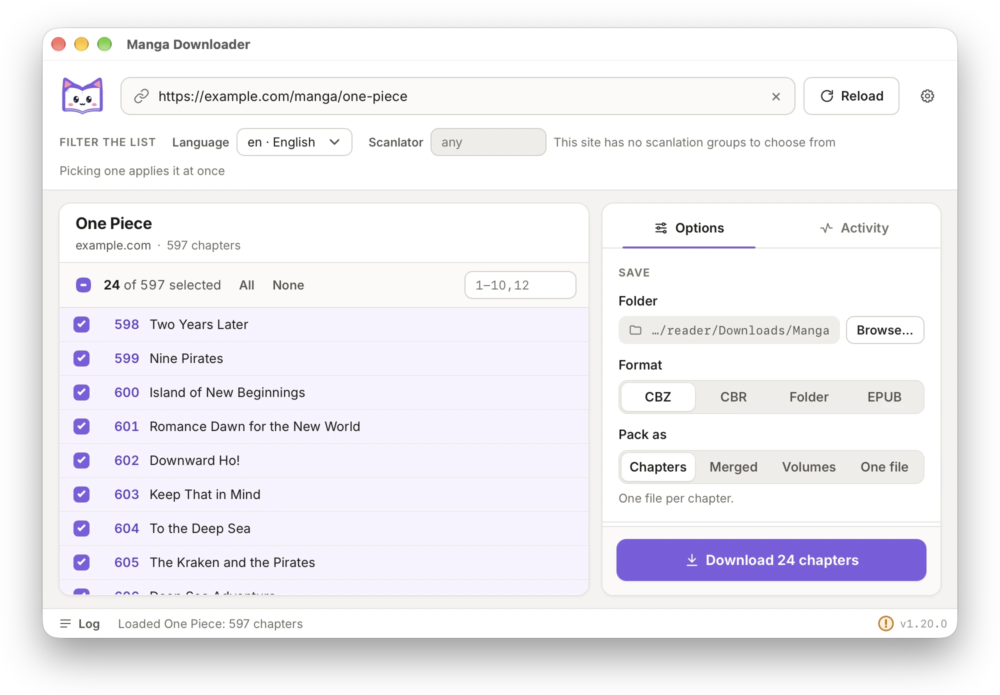
</picture>

The gear icon in the header (or Ctrl+, / ⌘,) opens Settings, where you pick the app's language (English, Español or Català). The same panel turns the update check on or off.

<picture>
  <source media="(prefers-color-scheme: dark)" srcset="assets/screenshots/13-settings-dark.webp">
  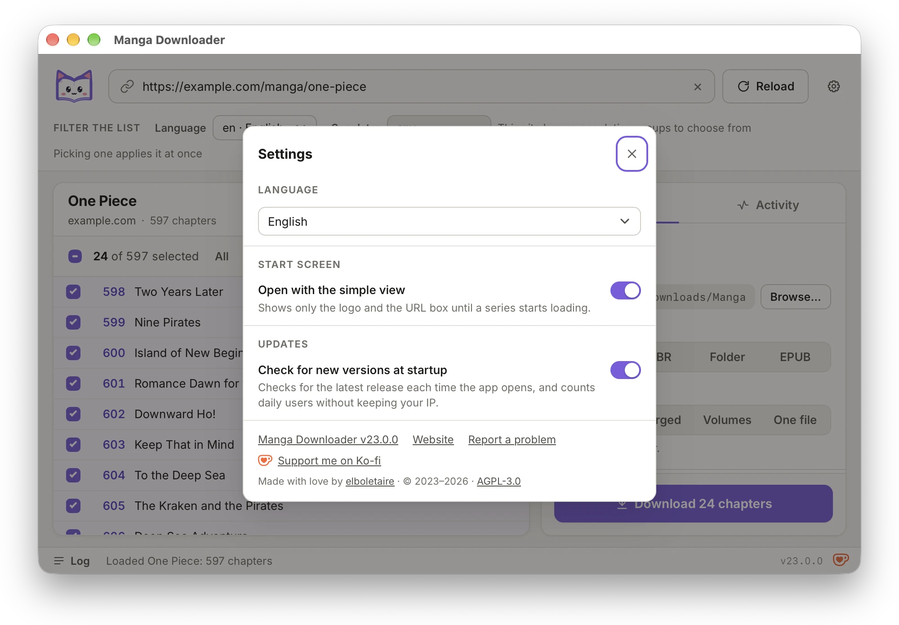
</picture>

### Command line

#### Homebrew

On macOS and Linux, install the command line tool from [Homebrew][homebrew]:

~~~bash
brew install elboletaire/tap/manga-downloader
~~~

Homebrew doesn't quarantine the command line tool, so there's no Gatekeeper
step on macOS. `brew upgrade manga-downloader` updates it.

This installs only the command line tool. On macOS, the
[desktop app](#desktop-app) is a separate cask, `manga-downloader-app`. Install
it as well to get `manga-downloader ui` working, or both at once:

~~~bash
brew install elboletaire/tap/manga-downloader elboletaire/tap/manga-downloader-app
~~~

#### Prebuilt binary

Download the archive for your system from the [releases page][releases], extract
it and run the binary:

~~~bash
./manga-downloader --help
~~~

To verify the download, check it against `manga-downloader-<tag>-SHA256SUMS.txt`
from the same release: `sha256sum -c --ignore-missing manga-downloader-<tag>-SHA256SUMS.txt`.

Builds are published for Linux, macOS and Windows on amd64 and arm64 (Windows
arm64 included), plus 32-bit builds for Linux and Windows. The Windows 32-bit
build is named `windows-32bit-legacy`.

To run it from any folder, move the binary to a folder in your `PATH`, such as
`/usr/local/bin` on Linux and macOS.

<b>Windows</b>: step-by-step setup

 

> [!IMPORTANT]
> Manga Downloader is a command line tool, so run it from a terminal, as shown
> below. Double-clicking `manga-downloader.exe` opens the desktop app when the
> app is next to it or on your `PATH`. Without it, the window only shows the help
> and waits for Enter.

1. Open **PowerShell**: press the Start button, type `PowerShell` and press
   <kbd>Enter</kbd>.
2. Paste this line and press <kbd>Enter</kbd>:

   ~~~powershell
   irm https://raw.githubusercontent.com/elboletaire/manga-downloader/master/install.ps1 | iex
   ~~~

3. Close the terminal and open a new one. Then run it from any folder:

   ~~~cmd
   manga-downloader https://mangadex.org/title/a1c7c817-4e59-43b7-9365-09675a149a6f/one-piece 1-10
   ~~~

The [install script](./install.ps1) downloads the latest release to
`%LOCALAPPDATA%\Programs\manga-downloader` and adds that folder to your `PATH`.
It doesn't need administrator rights. Run the same line again to update, and
delete that folder to uninstall.

> [!TIP]
> Files are saved in the folder the terminal is in. To download straight into
> a folder, open it in File Explorer, type `cmd` in the address bar and press
> <kbd>Enter</kbd>. A terminal opens there, ready to use.

Prefer not to run a script?

 

Download the `windows-amd64` zip from the [releases page][releases] (or
`windows-arm64` if you have an ARM device, such as a Snapdragon laptop), extract
it, and copy `manga-downloader.exe` to `C:\Windows\System32`. Windows asks for
administrator permission. After that, `manga-downloader` works in any terminal.

> [!WARNING]
> This works, but it isn't the best place for the program: it needs
> administrator rights and mixes it with Windows' own files. To update or
> uninstall it, you have to go back to that folder and replace or delete the
> file yourself.

If Windows SmartScreen shows *"Windows protected your PC"*, the binary is only
flagged because it isn't signed. Click **More info** → **Run anyway**.

<b>macOS</b>: allowing an unsigned binary

 

The binary isn't signed, so Gatekeeper blocks it the first time you run it:

1. Run `./manga-downloader` once and dismiss the warning.
2. Open **System Settings** → **Privacy & Security**, scroll down to
   **Security**, and click **Open Anyway** next to the *manga-downloader*
   message.
3. Run `./manga-downloader` again and confirm the dialog.

You only need to do this once.

#### Docker

~~~bash
docker run --rm -it -v "$PWD:/downloads" elboletaire/manga-downloader [url] [chapters]
~~~

Files are written to the mounted `/downloads` folder. They're owned by
`USER_ID`/`GROUP_ID`, which both default to `1000`. If your user has a
different ID, pass it with
`-e USER_ID=$(id -u) -e GROUP_ID=$(id -g)`.

`:latest` and `:browser` follow releases. The current development version is
`:master` (and `:master-browser`).

The default image has no browser. For sites marked with `*`, use the `:browser`
image, which ships Chromium and a virtual display:

~~~bash
docker run --rm -it -v "$PWD:/downloads" elboletaire/manga-downloader:browser [url] [chapters]
~~~

Showing the browser window on your own display

 

The `:browser` image passes Cloudflare challenges on its own. If a challenge
needs a real person, its window opens by itself, so forward your display to see
it on your Linux desktop. You may need to run `xhost +local:` first:

~~~bash
docker run --rm -it -e DISPLAY=$DISPLAY -v /tmp/.X11-unix:/tmp/.X11-unix \
    -v "$PWD:/downloads" elboletaire/manga-downloader:browser [url] [chapters]
~~~

## Using the desktop app

Open the app and follow these steps:

1. **Paste the series' URL** into the box at the top (or use its *Paste*
   button). The app loads the series on its own, without a button.
2. **Pick chapters** in the list. Type a range such as `1-10,12` and press
   Enter (or the + in the box), Shift+click to select a span, or use *All* and
   *None*. The arrow keys and Space work too. Locked chapters (paid or members-only) show
   a lock and can't be selected.
3. **Choose a language and a scanlation group** when the site offers them. The
   selectors tell you when a series has none, and picking one reloads the
   chapter list. Sites that support it also offer *All*.

   <picture>
     <source media="(prefers-color-scheme: dark)" srcset="assets/screenshots/03-language-selector-dark.webp">
     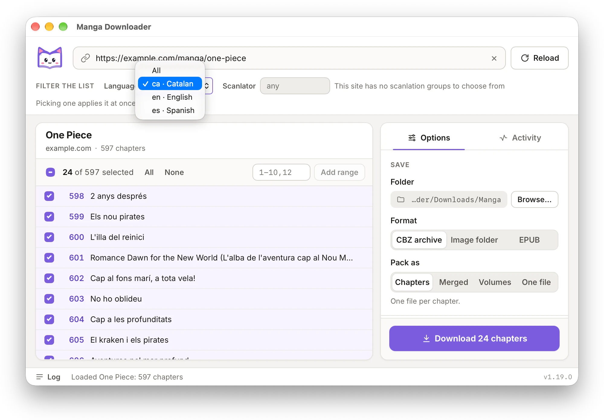
   </picture>

4. **Set the options** in the *Options* tab: where the files go, the format
   (CBZ, CBR, Folder or EPUB; EPUB adds a *Reading direction*), *Pack as*
   (a file per chapter, per volume, or one for everything), *Convert to JPEG*
   for AVIF and WebP pages, and pages to skip. Under *Advanced* are the file
   name template and *Show the browser window*, which you rarely need: a site
   that needs the window opens it by itself. Packing by volume adds a *Volumes*
   box above the chapter list. It starts empty, which packs the site's volumes;
   a line under it offers them as chapter ranges when they can be written that
   way. The list is grouped by volume.

   <picture>
     <source media="(prefers-color-scheme: dark)" srcset="assets/screenshots/06-options-dark.webp">
     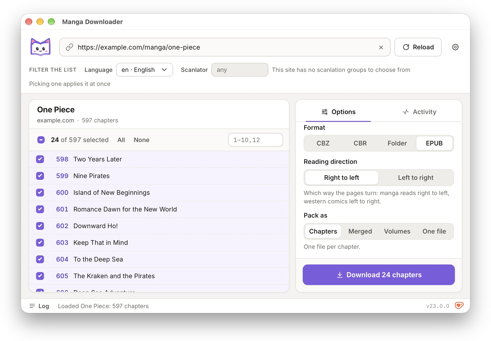
   </picture>

   When a site needs you at its browser window, an alert says so, with *Show the
   browser window* to bring it to the front and *Dismiss* to hide the alert.

   <picture>
     <source media="(prefers-color-scheme: dark)" srcset="assets/screenshots/08-browser-alert-dark.webp">
     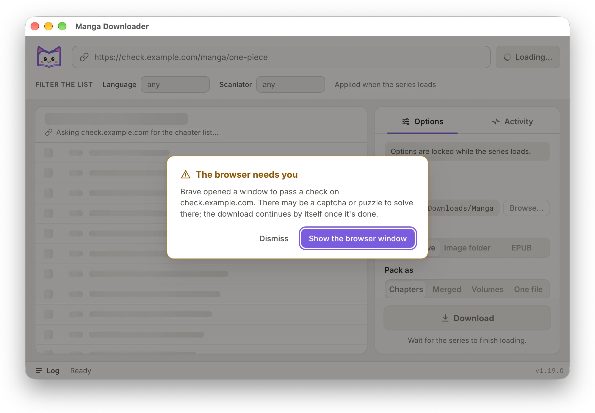
   </picture>

   <picture>
     <source media="(prefers-color-scheme: dark)" srcset="assets/screenshots/07-volumes-dark.webp">
     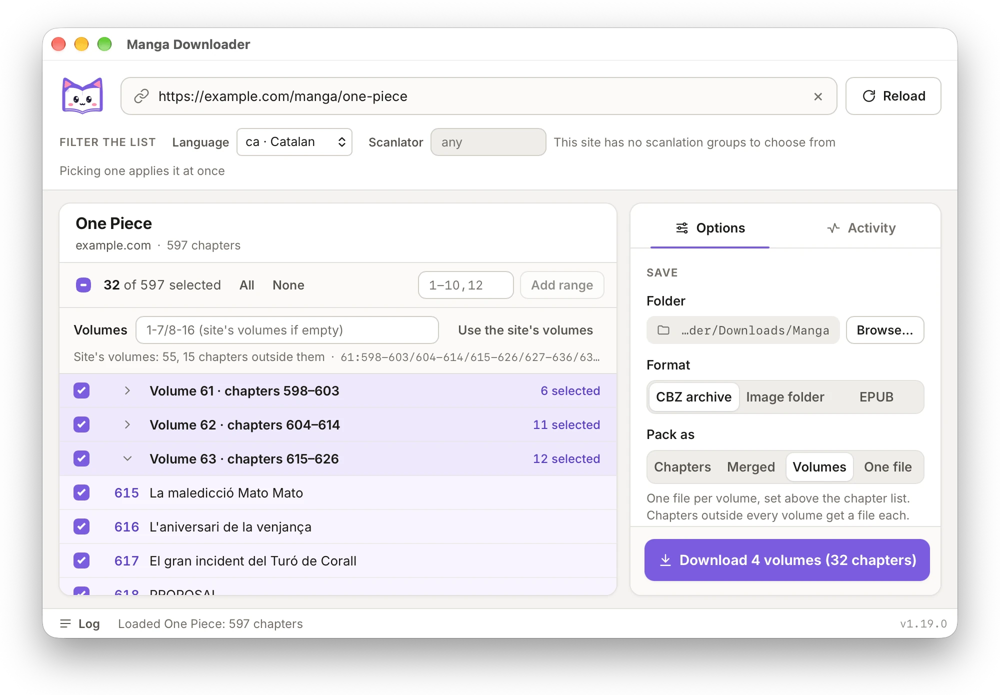
   </picture>

   *Pack as → Merged* packs a chapter's parts (19-① and 19-②) into one file named
   after the chapter, and leaves the chapters without parts as one file each.

   <picture>
     <source media="(prefers-color-scheme: dark)" srcset="assets/screenshots/12-parts-dark.webp">
     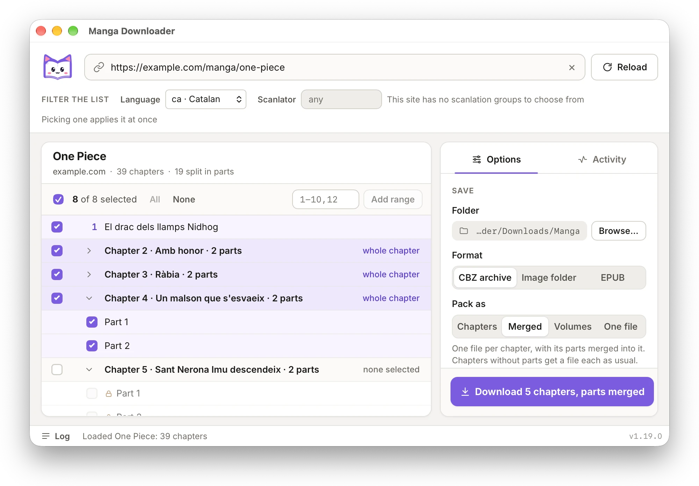
   </picture>

5. **Press Download.** The *Activity* tab shows each chapter as it's fetched and
   packed. *Cancel* lets the chapters already downloading finish, and starts no
   new ones. A log is one click away in the status bar.

   <picture>
     <source media="(prefers-color-scheme: dark)" srcset="assets/screenshots/04-downloading-dark.webp">
     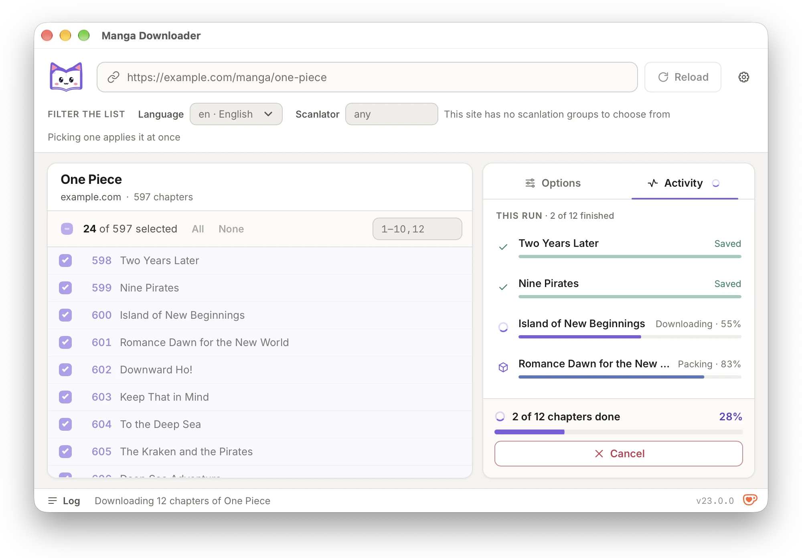
   </picture>

6. **When it's done**, the summary shows what was downloaded. Press
   *Open folder* to go straight to the files.

   <picture>
     <source media="(prefers-color-scheme: dark)" srcset="assets/screenshots/05-done-dark.webp">
     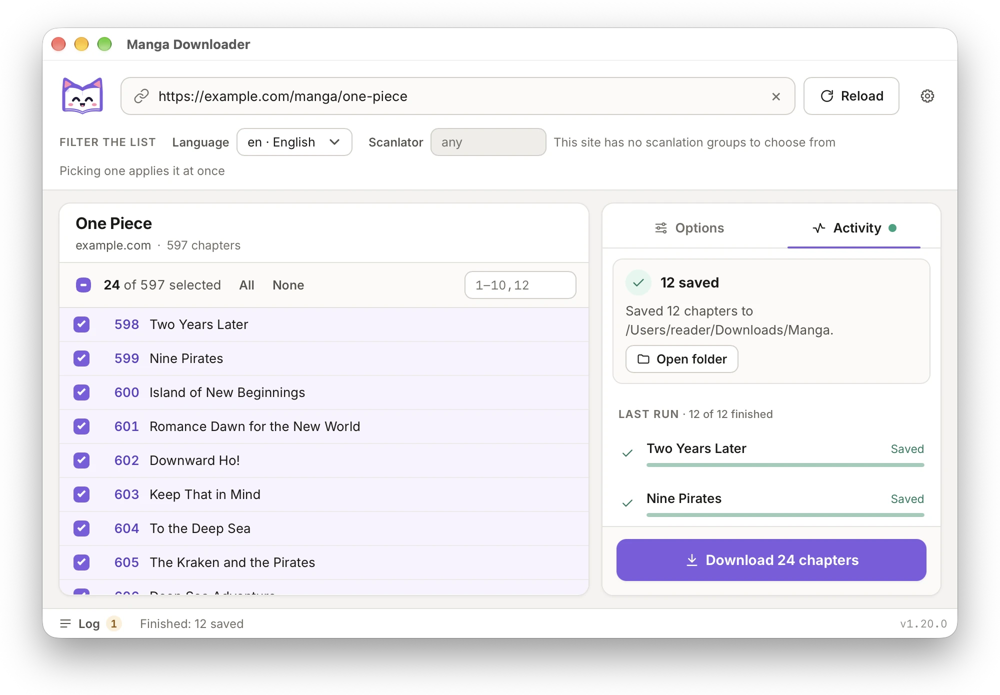
   </picture>

   If a chapter fails, the summary names it and says why; the other chapters
   are still saved.

   <picture>
     <source media="(prefers-color-scheme: dark)" srcset="assets/screenshots/10-failed-dark.webp">
     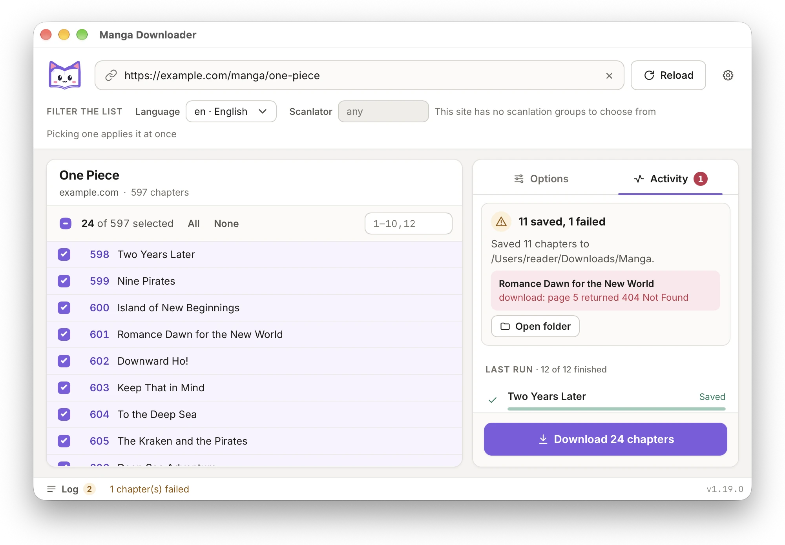
   </picture>

The app saves your options to `gui.json` in the `manga-downloader` folder of
your user config folder (the same place as the Manga Plus secret, see
[below](#environment-variables)), so they're still there the next time you open
it. Files go to your Downloads folder (or your home folder, if there isn't one)
unless you choose another folder.

The app uses the command line's defaults for concurrency and retries.
Sites whose image servers limit the request rate get lower limits
automatically, in both the app and the command line.

## Using the command line

~~~bash
manga-downloader [flags] [url] [chapters]
~~~

- `url` is the manga's **index page**, the page that lists all its chapters.
  The URL of a single chapter works too: it resolves to the whole series.
- `chapters` is a comma-separated list of numbers and ranges, such as
  `1,3,5-10`. If you leave it out, the tool asks whether to download every
  chapter. The answer defaults to "no".
  Chapters the site marks as locked (coins, early access or members-only) are skipped,
  with a line saying which.

Arguments aren't positional, so `manga-downloader 1-50 [url]` works too.

<picture>
  <source media="(prefers-color-scheme: dark)" srcset="assets/demos/download.gif">
  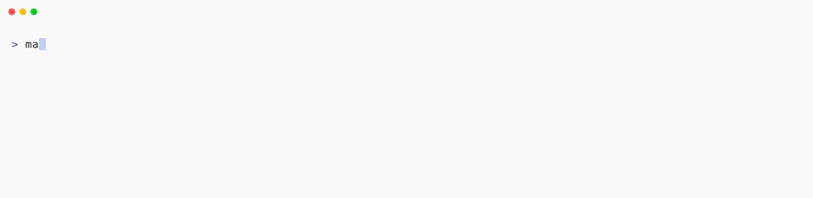
</picture>

Leave the range out and it asks before downloading the whole series:

<picture>
  <source media="(prefers-color-scheme: dark)" srcset="assets/demos/prompt.gif">
  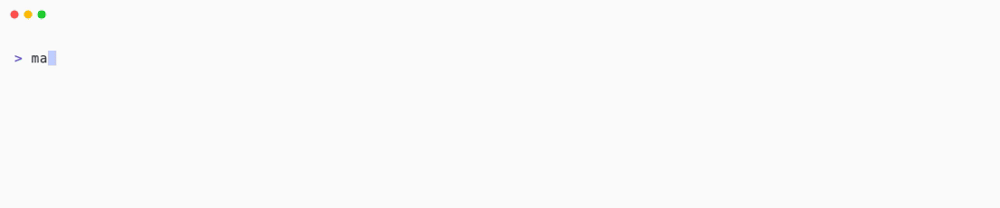
</picture>

### Language and scanlation group

Some sites, such as MangaDex, list each chapter once per language. Use
`--language` to download only one of them:

~~~bash
manga-downloader --language es https://mangadex.org/title/a1c7c817-4e59-43b7-9365-09675a149a6f 1-10
~~~

On sites that list several languages, `--language all` downloads every one of them.

Some sites host several scanlation groups' versions of the same chapter. By
default every release is kept, and each one is told apart by its group: the
chapter list shows the group, and `{{.Group}}` in `--filename-template` names
it. Use `--scanlator <name>` to keep only one group's releases (the name is
matched ignoring case; an unknown one lists the groups the series has), or
`--scanlator all` for every group, which is the same as the default. Releases
that name no group are left out whenever a group is selected.

The default file name adds the release's group in brackets when it names one
(`One Piece 5 - Chapter 5 [Alpha]`), so each release keeps its own file. A
template without `{{.Group}}` only tells the releases apart by a version
suffix (`v2`, `v3`…), in no particular group order.

<picture>
  <source media="(prefers-color-scheme: dark)" srcset="assets/demos/groups.gif">
  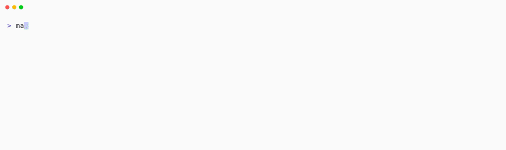
</picture>

### Bundling and output format

~~~bash
# all chapters in a single CBZ, one folder per chapter inside it
manga-downloader --bundle [url] 1-8

# CBR archives instead of CBZ files, for readers that prefer RAR
manga-downloader --format cbr [url] 1-8

# plain image folders instead of CBZ files
manga-downloader --format raw [url] 1-8

# EPUB e-books, read left to right (western comics)
manga-downloader --format epub --reading-direction ltr [url] 1-8
~~~

<picture>
  <source media="(prefers-color-scheme: dark)" srcset="assets/demos/bundle.gif">
  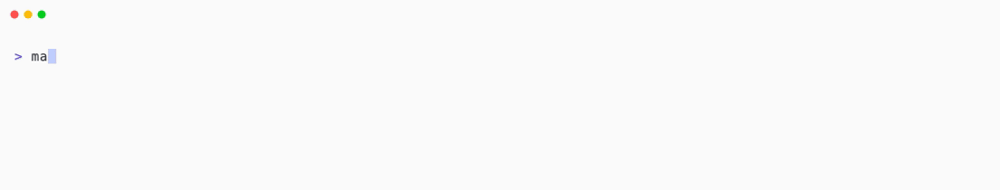
</picture>

### Volumes

`--volumes` packs one file per volume. `auto` uses the volumes the site files
chapters under (not every site lists them); otherwise give the chapters of each
volume, separated by slashes, in the chapter range syntax:

~~~bash
manga-downloader --volumes 1-7/8-16 [url] 1-20
~~~

That writes `Series Vol. 01.cbz` and `Series Vol. 02.cbz` (`.cbr` with
`--format cbr`, `.epub` with `--format epub`), with a folder per chapter
inside, and chapters 17 to 20, outside every volume, one file each. The
chapters argument still picks what's downloaded: a volume packs the chapters
of it you asked for. A group can give its volume number with `N:`, and the
groups after it count on from there:

~~~bash
manga-downloader --volumes 16:112-114/115-118 [url] 112-118
~~~

That's volumes 16 and 17. An empty group also skips a number (`1-7//20-30` has
no volume 2), and `--volumes` can't be combined with `--bundle`.

`parts` packs the parts of a chapter (the releases sharing its number, group and language,
like 19-① and 19-②) into one file named after the chapter, with a folder per part:

~~~bash
manga-downloader --volumes parts [url] 18-19
~~~

That writes `Series 19 - Chapter 19 [Group].cbz` next to the chapters without parts.

<picture>
  <source media="(prefers-color-scheme: dark)" srcset="assets/demos/volumes.gif">
  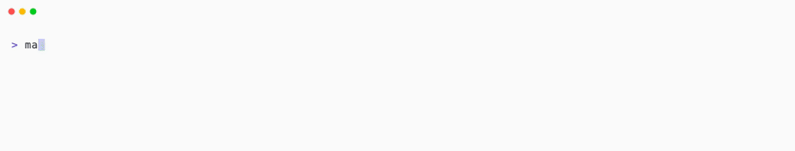
</picture>

### Image conversion

Most e-readers can't display AVIF, so a chapter with AVIF pages looks empty on
the device even though the download succeeded. **AVIF pages are converted to
JPEG by default.** WebP renders fine in phone apps but is unreliable on e-ink,
so converting it is opt-in:

~~~bash
manga-downloader --convert-images avif,webp [url] 1-10   # strict e-ink setup
manga-downloader --convert-images none [url] 1-10        # keep pages untouched
~~~

JPEG, PNG and GIF pages are never re-encoded. If a page fails to convert, it's
kept as it was and a warning is shown, so the rest of the chapter isn't lost.

EPUB is the exception, since readers can't show AVIF at all: AVIF pages are
always converted for it, even with `--convert-images none`. A page an EPUB can't
show (anything but JPEG, PNG, GIF or WebP, such as an AVIF that failed to convert)
is left out with a warning instead of being kept.

> [!NOTE]
> The AVIF decoder is embedded as WebAssembly, so you don't need to install any
> system library. It's slower on the 32-bit builds (`linux-386` and
> `windows-32bit-legacy`), so use `--convert-images none` there if speed
> matters.

The desktop app offers the same choice as two checkboxes, *AVIF* and *WebP*.
With EPUB, AVIF is always converted, so its box is ticked and can't be changed.

### Skipping pages

Scanlation groups often reserve a page or two of every chapter for their own
credits or ads. `--skip-pages` drops them, using the same range syntax as the
chapter argument, applied to each chapter's pages:

~~~bash
manga-downloader --skip-pages 2 [url] 1100-1110       # just the credits page
manga-downloader --skip-pages 2,5-7 [url] 1100-1110   # several at once
~~~

Pages count from 1, and **negative positions count backwards from the end of
the chapter**: `-1` is its last page, `-3--1` the last three. They're resolved
per chapter, so `-1` means each chapter's own last page however long it is:

~~~bash
manga-downloader --skip-pages 2,-1 [url] 1100-1110    # one at each end
~~~

The pages are dropped **before** they're downloaded, so they cost no time or
bandwidth, and a page that's broken on the site's end can't fail the chapter
around it — which is the only way to download a chapter whose page 404s.

The archive is still numbered `000`, `001`, … in order, with no holes left by
the skipped pages. A position the chapter doesn't have is ignored.

> [!TIP]
> Both `--skip-pages -1` and `--skip-pages=-1` work: the value right after the
> flag is taken verbatim, dash and all. Use the `=` form if a shell or a
> wrapper script trips on the leading dash.

### File names

Use `--filename-template` to change file names. It takes a
[Go text/template][go template] string, and the default is:

~~~
{{.Series}} {{.Number}} - {{.Title}}{{if .Group}} [{{.Group}}]{{end}}{{if gt .Version 1}} v{{.Version}}{{end}}
~~~

`{{.Version}}` is a counter that's added when two files would have the same
name, and `{{.Volume}}` is the volume number (0 when the site doesn't say);
`{{printf "%02d" .Volume}}` pads it. A template that leaves `{{.Version}}` out
still gets the suffix when names collide: the second file is `X v2`, the third
`X v3`, and so on, so `{{.Series}} {{.Number}} [{{.Group}}]` never overwrites a
release.

Volume files (`--volumes`) get their own default name while the template is
left as is:

~~~
{{.Series}} Vol. {{printf "%02d" .Volume}}{{if .Group}} [{{.Group}}]{{end}}{{if gt .Version 1}} v{{.Version}}{{end}}
~~~

A custom template names them too, with `{{.Number}}` being the volume's
chapters (`1-7`) and `{{.Title}}` `Vol. 01`.

`{{.Title}}` is the chapter's label: its title, or `Chapter 12` when the site
gives none. `{{.SiteTitle}}` is the site's own title alone, empty when it gives
none and for a volume or a bundle.

`pad` zero-pads a number's whole part and keeps its decimals: `{{pad .Number 4}}`
is `0005` for chapter 5 and `0010.5` for 10.5. MangaDex chapters used to be
named with a padded label; this template names per-chapter MangaDex downloads
that way again (with `Capítulo` in place of `Chapter` for InManga), except that
decimal chapters keep their real number (`0010.5`). Like any custom template,
it also names `--volumes` files, and in the app it applies to every site:

~~~
{{.Series}} {{.Number}} - Chapter {{pad .Number 4}}{{if .SiteTitle}} {{.SiteTitle}}{{end}}{{if .Group}} [{{.Group}}]{{end}}{{if gt .Version 1}} v{{.Version}}{{end}}
~~~

`{{.Group}}` is the scanlation group that made the release (empty when the site
doesn't say). A volume or a bundle gets its group only when all of its chapters
were made by the same one, so mixed groups leave it empty.

### Environment variables

| Variable           | Description                                    |
| ------------------ | ---------------------------------------------- |
| `MANGAPLUS_SECRET` | Anonymous device secret to use for Manga Plus |

**Manga Plus** answers the complete chapter list only to an app client, which
authenticates with an anonymous device secret. manga-downloader registers one
on first use and caches it in `manga-downloader/mangaplus-secret` inside your
user config folder (`$XDG_CONFIG_HOME` or `~/.config` on Linux,
`~/Library/Application Support` on macOS, `%AppData%` on Windows): no account is
ever needed. Secrets are 32 lowercase hexadecimal characters, and anything that
isn't one is treated as absent — so exporting a malformed `MANGAPLUS_SECRET`,
or deleting the cached file, makes the next run register a fresh device, as
does a cached secret the API stops accepting. Export a valid
`MANGAPLUS_SECRET` to reuse a secret registered elsewhere, such as the one of a
device with your Manga Plus subscription.

In **Docker**, the cached secret lives inside the container and is lost with
it, so every run registers a new device. To keep one, either pass it with
`-e MANGAPLUS_SECRET=...`, or mount your own config folder so the container
shares the secret of your local install (create the folder first, or Docker
creates it owned by root):

~~~bash
mkdir -p ~/.config/manga-downloader
docker run --rm -it -v "$PWD:/downloads" \
    -v ~/.config/manga-downloader:/home/manga/.config/manga-downloader \
    elboletaire/manga-downloader [url] [chapters]
~~~

Manga Plus also publishes **one edition per language**, and their chapter
lists differ: some list the whole series, others only a handful of chapters.
A URL points at one edition, and `--language` downloads another one instead
(`--language en` on a Spanish URL downloads the English edition).

### Options

| Flag                  | Short | Description                                              | Default        |
| --------------------- | ----- | -------------------------------------------------------- | -------------- |
| `--output-dir`        | `-o`  | Folder to write the downloaded files to                  | current folder |
| `--bundle`            | `-b`  | Bundle all chapters into a single file                   | off            |
| `--volumes`           |       | One file per volume: `auto`, `parts`, `1-7/8-16`         | off            |
| `--format`            | `-f`  | Output format: `cbz`, `cbr`, `raw` or `epub`             | `cbz`          |
| `--reading-direction` |       | Page turn direction for EPUB: `rtl` (manga) or `ltr`     | `rtl`          |
| `--filename-template` | `-t`  | Template for the file names                              | see above      |
| `--language`          | `-l`  | Only download the specified language                     | site default   |
| `--scanlator`         | `-s`  | Only download the specified scanlation group (or `all`)  | `all`          |
| `--convert-images`    |       | Formats to convert to JPEG: `avif`, `webp` or `none`     | `avif`         |
| `--skip-pages`        |       | Pages to exclude from every chapter (`-1` is the last)   | none           |
| `--concurrency`       | `-c`  | Number of chapters downloaded at once (max 5)            | 5              |
| `--concurrency-pages` | `-C`  | Number of pages downloaded at once per chapter (max 10)  | 10             |
| `--retry`             | `-r`  | Retries per failed page (max 3, `0` disables retrying)   | 1              |
| `--browser-visible`   |       | Always show the browser window (rarely needed)           | off            |
| `--version`           | `-v`  | Show version information                                 |                |

Run `manga-downloader help` to list them in your terminal.

Some sites cap the concurrency lower, because their image servers refuse
requests that come too fast; a lower value still applies there. Pages refused
for coming too fast (a 429) are retried after the wait the server asks for, up
to a minute.

## Supported sites

<b>Show all 201 supported sites</b>

 

| Site | Notes | Last verified |
| --- | --- | --- |
| [3asq.online](https://3asq.online) | Arabic, former 3asq.org | 2026-10-18 |
| [afroditscans.com](https://afroditscans.com) | Turkish | 2026-10-18 |
| [anikiga.com](https://anikiga.com) | Turkish | 2026-10-18 |
| [animeallstar1.com](https://www.animeallstar1.com) | AnimeAllStar, Spanish | 2026-10-18 |
| [animeallstar30.com](https://animeallstar30.com) | AnimeAllStar, Spanish | 2026-10-18 |
| [anzmanga25.com](https://www.anzmanga25.com) | AnzManga, Spanish | 2026-10-18 |
| [apollcomics.es](https://apollcomics.es) | Spanish | 2026-10-18 |
| [arenascan.com](https://arenascan.com) |  | 2026-10-18 |
| [asmotoon.com](https://asmotoon.com) \* | Asmodeus Scans | 2026-10-15 |
| [asurascans.com](https://asurascans.com) | Asura Scans, former asuratoon.com | 2026-10-18 |
| [atsu.moe](https://atsu.moe) | Atsumaru | 2026-10-18 |
| [aurorascans.com](https://aurorascans.com) | redirects to qimanga.com | 2026-10-18 |
| [azorafly.com](https://azorafly.com) | Azorafly, Arabic | 2026-10-18 |
| [bigcomics.jp](https://bigcomics.jp) | Japanese, Big Comics (Comici) | 2026-10-18 |
| [bigsolo.org](https://bigsolo.org) |  | 2026-10-15 |
| [blackcloveronline.com](https://blackcloveronline.com) | Black Clover | 2026-10-18 |
| [bluesolo.org](https://bluesolo.org) | Blue Solo, French scantrad | 2026-10-18 |
| [chainsawman-chapter.online](https://chainsawman-chapter.online) | Chainsaw Man | 2026-10-18 |
| [chainsawmannmanga.com](https://chainsawmannmanga.com) | Chainsaw Man | 2026-10-18 |
| [championcross.jp](https://championcross.jp) | Japanese, Champion Cross (Comici) | 2026-10-18 |
| [comic-action.com](https://comic-action.com) | Japanese, Web Action (GigaViewer) | 2026-10-18 |
| [comic-days.com](https://comic-days.com) | Japanese, Comic DAYS (GigaViewer) | 2026-10-18 |
| [comic-earthstar.com](https://comic-earthstar.com) | Japanese, Comic Earth Star (GigaViewer) | 2026-10-18 |
| [comic-gardo.com](https://comic-gardo.com) | Japanese, Comic Gardo (GigaViewer) | 2026-10-18 |
| [comic-growl.com](https://comic-growl.com) | Japanese, Comic Growl (Comici) | 2026-10-18 |
| [comic-ogyaaa.com](https://comic-ogyaaa.com) | Japanese, Comic Ogyaaa (GigaViewer) | 2026-10-18 |
| [comic-ryu.jp](https://comic-ryu.jp) | Japanese, Comic Ryu (Comici) | 2026-10-18 |
| [comic-seasons.com](https://comic-seasons.com) | Japanese, Seasons (GigaViewer) | 2026-10-18 |
| [comic-trail.com](https://comic-trail.com) | Japanese, Comic Trail (GigaViewer) | 2026-10-18 |
| [comic-walker.com](https://comic-walker.com) | Japanese, KadoComi (KADOKAWA) | 2026-10-18 |
| [comic-y-ours.com](https://comic-y-ours.com) | Japanese, Comic Y-Ours (GigaViewer) | 2026-10-18 |
| [comic-zenon.com](https://comic-zenon.com) | Japanese, Comic Zenon (GigaViewer) | 2026-10-18 |
| [comic.naver.com](https://comic.naver.com) | Naver Webtoon, Korean, free episodes only | 2026-10-18 |
| [comicborder.com](https://comicborder.com) | Japanese, Comic Border (GigaViewer) | 2026-10-18 |
| [comicride.jp](https://comicride.jp) | Japanese, Comic Ride (Comici) | 2026-10-18 |
| [comix.to](https://comix.to) \* |  | 2026-10-15 |
| [danke.moe](https://danke.moe) | Danke fürs Lesen | 2026-10-18 |
| [decadencescans.com](https://reader.decadencescans.com) | Decadence Scans, slow image host | 2026-10-18 |
| [deathtollscans.net](https://reader.deathtollscans.net) |  | 2026-10-18 |
| [demonicscans.org](https://demonicscans.org) | MangaDemon / Demonic Scans | 2026-10-18 |
| [dragonballmangaa.com](https://dragonballmangaa.com) | Dragon Ball Super | 2026-10-18 |
| [dragontea.ink](https://dragontea.ink) \* |  | 2026-10-15 |
| [drakecomic.net](https://drakecomic.net) | Drake Scans, former drakecomic.org | 2026-10-15 |
| [dynasty-scans.com](https://dynasty-scans.com) | Dynasty Reader | 2026-10-18 |
| [eldermanga.com](https://eldermanga.com) |  | 2026-10-18 |
| [elftoon.net](https://elftoon.net) | Elf Toon, former elftoon.com | 2026-10-18 |
| [en-hijala.com](https://en-hijala.com) | Hijala Translations | 2026-10-18 |
| [en-thunderscans.com](https://en-thunderscans.com) | Thunderscans | 2026-10-18 |
| [eskimangalar.com](https://eskimangalar.com) |  | 2026-10-18 |
| [evascans.net](https://evascans.net) | former evascans.org | 2026-10-18 |
| [fanfox.net](https://fanfox.net) | Manga Fox | 2026-10-18 |
| [fbsquadx.com](https://fbsquadx.com) | Fleur Blanche Scan, Spanish | 2026-10-18 |
| [feelweb.jp](https://feelweb.jp) | Japanese, Feel Web (GigaViewer) | 2026-10-18 |
| [flamecomics.xyz](https://flamecomics.xyz) | Flame Comics, former Flame Scans | 2026-10-18 |
| [fmteam.fr](https://fmteam.fr) |  | 2026-10-18 |
| [furyosociety.com](https://furyosociety.com) |  | 2026-10-18 |
| [gdscans.com](https://gdscans.com) | GalaxyDegenScans | 2026-10-18 |
| [genztoons.org](https://genztoons.org) | Genz Toon, former genzupdates.com | 2026-10-18 |
| [globalcomix.com](https://globalcomix.com) | Western comics, free issues only | 2026-10-18 |
| [gourmetsupremacy.com](https://gourmetsupremacy.com) | Gourmet Scans, free chapters only | 2026-10-18 |
| [guya.moe](https://guya.moe) | Guya, Kaguya-sama | 2026-10-18 |
| [hachirumi.com](https://hachirumi.com) | Hachirumi, Guya instance, has an NSFW section | 2026-10-18 |
| [heavenly-delusion.com](https://heavenly-delusion.com) | Heavenly Delusion | 2026-10-18 |
| [heavenmanga.com](https://heavenmanga.com) | Spanish | 2026-10-18 |
| [hentai20.io](https://hentai20.io) | English, mostly NSFW | 2026-10-18 |
| [heros-web.com](https://heros-web.com) | Japanese, Hero's Web (Comici) | 2026-10-18 |
| [hivetoons.org](https://hivetoons.org) | HiveToons, VoidScans | 2026-10-15 |
| [ichicomi.com](https://ichicomi.com) | Japanese, Ichi Comic (GigaViewer) | 2026-10-18 |
| [inmanga.com](https://inmanga.com) |  | 2026-10-18 |
| [jestful.net](https://jestful.net) |  | 2026-10-18 |
| [jojolandsmanga.com](https://jojolandsmanga.com) | The JoJoLands | 2026-10-18 |
| [jujutsukaisenmanga.pro](https://jujutsukaisenmanga.pro) | Jujutsu Kaisen | 2026-10-18 |
| [kansai.mag-garden.co.jp](https://kansai.mag-garden.co.jp) | Japanese, Mag Garden Kansai (Comici) | 2026-10-18 |
| [kappabeast.com](https://kappabeast.com) \* |  | 2026-10-15 |
| [kaynscans.com](https://kaynscans.com) | Kayn Scans, former kaynscan.org | 2026-10-18 |
| [kingofshojo.com](https://kingofshojo.com) |  | 2026-10-18 |
| [kombatch.cc](https://kombatch.cc) | Indonesian | 2026-10-18 |
| [komikdewasa.art](https://komikdewasa.art) | Indonesian, mostly NSFW | 2026-10-18 |
| [komikindo.ch](https://komikindo.ch) |  | 2026-10-18 |
| [komikmanga.com](https://komikmanga.com) | MangaReader, English | 2026-10-18 |
| [komikstation.org](https://komikstation.org) | Indonesian | 2026-10-18 |
| [ksgroupscans.com](https://ksgroupscans.com) | KSGroupScans | 2026-10-18 |
| [kuragebunch.com](https://kuragebunch.com) | Japanese, Kurage Bunch (GigaViewer) | 2026-10-18 |
| [lagoonscans.com](https://lagoonscans.com) |  | 2026-10-18 |
| [leercapitulo.co](https://www.leercapitulo.co) |  | 2026-10-18 |
| [lelmanga.com](https://www.lelmanga.com) | French | 2026-10-18 |
| [lelscanfr.com](https://www.lelscanfr.com) | French | 2026-10-18 |
| [lelscans.net](https://lelscans.net) | French | 2026-10-18 |
| [lhtranslation.net](https://lhtranslation.net) | LHTranslation | 2026-10-18 |
| [lilymanga.net](https://lilymanga.net) | yuri, some NSFW | 2026-10-15 |
| [limonmanga.com](https://limonmanga.com) |  | 2026-10-18 |
| [luacomic.org](https://luacomic.org) | LuaScans | 2026-10-15 |
| [madaradex.org](https://madaradex.org) | some adult titles | 2026-10-18 |
| [madarascans.net](https://madarascans.net) | former madarascans.org/.com | 2026-10-18 |
| [magcomi.com](https://magcomi.com) | Japanese, Mag Garden (GigaViewer) | 2026-10-18 |
| [maid.my.id](https://www.maid.my.id) |  | 2026-10-18 |
| [manga.adonisfansub.com](https://manga.adonisfansub.com) | Adonis Fansub, Turkish | 2026-10-18 |
| [manga.smuglo.li](https://manga.smuglo.li) | Lilyreader, yuri | 2026-10-18 |
| [mangaball.com](https://mangaball.com) | former mangaball.net | 2026-10-18 |
| [mangabats.com](https://www.mangabats.com) | former mangabat.com | 2026-10-18 |
| [mangaberri.com](https://mangaberri.com) |  | 2026-10-18 |
| [mangadelsiglotvmanga.com.mx](https://www.mangadelsiglotvmanga.com.mx) | Manga del Siglo TV Manga, Spanish | 2026-10-18 |
| [mangadenizi.net](https://www.mangadenizi.net) |  | 2026-10-18 |
| [mangadex.org](https://mangadex.org) | MangaDex | 2026-10-18 |
| [mangadistrict.com](https://mangadistrict.com) | English, mostly NSFW | 2026-10-18 |
| [mangaeclipse.com](https://mangaeclipse.com) | Manga Eclipse | 2026-10-18 |
| [mangafire.to](https://mangafire.to) \* |  | 2026-10-15 |
| [mangahere.cc](https://www.mangahere.cc) | MangaHere | 2026-10-18 |
| [mangahub.io](https://mangahub.io) \* |  | 2026-10-15 |
| [mangak.io](https://mangak.io) | MangaK, former mangabuddy.com | 2026-10-18 |
| [mangakakalot.gg](https://www.mangakakalot.gg) \* | MangaKakalot | 2026-10-15 |
| [mangakatana.com](https://mangakatana.com) |  | 2026-10-18 |
| [mangalami.com](https://mangalami.com) | LamiManga, Thai | 2026-10-18 |
| [mangalib.me](https://mangalib.me) | MangaLib | 2026-10-15 |
| [mangalivre.to](https://mangalivre.to) | Manga Livre, former mangalivre.tv/mangalivre.net | 2026-10-18 |
| [manganato.gg](https://www.manganato.gg) \* | MangaNato | 2026-10-18 |
| [mangaowl.io](https://mangaowl.io) | English | 2026-10-18 |
| [mangapark.cc](https://mangapark.cc) | MangaPark | 2026-10-18 |
| [mangapill.com](https://mangapill.com) |  | 2026-10-18 |
| [mangaplus.shueisha.co.jp](https://mangaplus.shueisha.co.jp) | Manga Plus, Shueisha's official reader | 2026-10-15 |
| [mangaread.org](https://www.mangaread.org) |  | 2026-10-18 |
| [mangas-origines.fr](https://mangas-origines.fr) | French | 2026-10-18 |
| [mangasushi.org](https://mangasushi.org) |  | 2026-10-18 |
| [mangasusuku.com](https://mangasusuku.com) | Indonesian, mostly NSFW | 2026-10-18 |
| [mangataro.org](https://mangataro.org) |  | 2026-10-18 |
| [mangatime-square.com](https://mangatime-square.com) | Japanese, Mangatime Square (GigaViewer) | 2026-10-18 |
| [mangatown.com](https://www.mangatown.com) |  | 2026-10-18 |
| [mangavault.lat](https://mangavault.lat) | MangaVault | 2026-10-18 |
| [mangaworld.mx](https://www.mangaworld.mx) | MangaWorld, Italian | 2026-10-18 |
| [mangawow.org](https://mangawow.org) | MangaWOW, Turkish | 2026-10-18 |
| [mangazin.org](https://mangazin.org) | MANGA ZIN | 2026-10-18 |
| [mangtto.com](https://mangtto.com) | Mangitto | 2026-10-15 |
| [manhuaplus.com](https://manhuaplus.com) |  | 2026-10-18 |
| [manhuatop.org](https://manhuatop.org) \* |  | 2026-10-15 |
| [manhuaus.com](https://manhuaus.com) \* |  | 2026-10-15 |
| [manhwabuddy.com](https://manhwabuddy.com) | English, raws | 2026-10-18 |
| [manhwaonline.org](https://manhwaonline.org) |  | 2026-10-18 |
| [manhwatop.com](https://manhwatop.com) | MANHWATOP | 2026-10-18 |
| [mgeko.cc](https://www.mgeko.cc) |  | 2026-10-18 |
| [mistscans.com](https://mistscans.com) |  | 2026-10-18 |
| [mkissa.to](https://mkissa.to) \* |  | 2026-10-15 |
| [mundomanhwa.com](https://mundomanhwa.com) | Spanish | 2026-10-18 |
| [nabicix.com](https://www.nabicix.com) | Turkish, former nabimanga.com | 2026-10-18 |
| [natomanga.com](https://www.natomanga.com) \* | MangaNato, former manganato.com/manganelo.com | 2026-10-15 |
| [natsu.one](https://natsu.one) | NatsuID, Indonesian, some adult titles, former natsu.id | 2026-10-18 |
| [niji-translations.com](https://niji-translations.com) | Niji, Arabic, yuri | 2026-10-18 |
| [noranofansub.com](https://www.noranofansub.com) | NoraNoFansub, Spanish | 2026-10-18 |
| [nyraxmanga.com](https://nyraxmanga.com) | Nyrax, some adult titles | 2026-10-18 |
| [onma.top](https://onma.top) | Arabic | 2026-10-18 |
| [oremanga.net](https://www.oremanga.net) | Oremanga, Thai | 2026-10-18 |
| [ourfeel.jp](https://ourfeel.jp) | Japanese, Our Feel (GigaViewer) | 2026-10-18 |
| [projectsuki.com](https://projectsuki.com) |  | 2026-10-18 |
| [qimanga.com](https://qimanga.com) |  | 2026-10-18 |
| [rackusreads.com](https://rackusreads.com) | Rackus | 2026-10-18 |
| [ravenscans.org](https://ravenscans.org) |  | 2026-10-18 |
| [rawkuma.net](https://rawkuma.net) |  | 2026-10-18 |
| [re-yume.my.id](https://www.re-yume.my.id) | Re-Yume, Indonesian | 2026-10-18 |
| [ritharscans.com](https://ritharscans.com) |  | 2026-10-18 |
| [rizzfables.com](https://rizzfables.com) |  | 2026-10-18 |
| [rokaricomics.com](https://rokaricomics.com) |  | 2026-10-18 |
| [roliascan.com](https://roliascan.com) |  | 2026-10-18 |
| [ruyamanga2.com](https://www.ruyamanga2.com) | Rüya Manga, Turkish | 2026-10-18 |
| [sacachispa.site](https://sacachispa.site) |  | 2026-10-15 |
| [sanascans.com](https://sanascans.com) | Sana Scans | 2026-10-18 |
| [scan-vf.net](https://www.scan-vf.net) | ScanVF | 2026-10-18 |
| [sektedoujin.cc](https://sektedoujin.cc) | Indonesian, mostly NSFW | 2026-10-18 |
| [sereinscan.com](https://sereinscan.com) | Turkish | 2026-10-18 |
| [setsuscans.com](https://setsuscans.com) \* |  | 2026-10-15 |
| [shonenjumpplus.com](https://shonenjumpplus.com) | Japanese, Jump+ (GigaViewer) | 2026-10-18 |
| [silentquill.net](https://silentquill.net) | Armageddon Scanlation | 2026-10-15 |
| [stonescape.xyz](https://stonescape.xyz) |  | 2026-10-18 |
| [sunday-webry.com](https://www.sunday-webry.com) | Japanese, Sunday Webry (GigaViewer) | 2026-10-18 |
| [sushiscan.net](https://sushiscan.net) \* |  | 2026-10-15 |
| [taiyo.moe](https://taiyo.moe) |  | 2026-10-18 |
| [takecomic.jp](https://takecomic.jp) | Japanese, Take Comic (Comici) | 2026-10-18 |
| [tcbonepiecechapters.com](https://tcbonepiecechapters.com) | TCB Scans, former tcbscans.com | 2026-10-18 |
| [team-shadowi.com](https://www.team-shadowi.com) |  | 2026-10-15 |
| [templetoons.com](https://templetoons.com) \* | Temple Scan | 2026-10-15 |
| [the-apothecary-diaries.com](https://the-apothecary-diaries.com) | The Apothecary Diaries | 2026-10-18 |
| [tonarinoyj.jp](https://tonarinoyj.jp) | Japanese, Young Jump (GigaViewer) | 2026-10-18 |
| [toongod.org](https://www.toongod.org) \* |  | 2026-10-15 |
| [toonily.com](https://toonily.com) \* |  | 2026-10-15 |
| [tortugaceviri.com](https://tortugaceviri.com) | Tortuga Çeviri | 2026-10-18 |
| [tritinia.org](https://tritinia.org) | Tritinia Scans | 2026-10-18 |
| [trmanga.com](https://trmanga.com) |  | 2026-10-15 |
| [turkcemanga.com](https://turkcemanga.com) | Turkce Manga, Turkish | 2026-10-18 |
| [tvymanga3.com](https://tvymanga3.com) | Tv y Manga, Spanish | 2026-10-18 |
| [twmanga.com](https://www.twmanga.com) | 包子漫画, baozimh.com mirror | 2026-10-15 |
| [utoon.us](https://www.utoon.us) | UToon, home of reset-scans' content | 2026-10-18 |
| [uzaymanga.com](https://uzaymanga.com) |  | 2026-10-18 |
| [violetscans.org](https://violetscans.org) |  | 2026-10-18 |
| [vortexscans.org](https://vortexscans.org) |  | 2026-10-18 |
| [webtoonia.fun](https://webtoonia.fun) | Turkish, former diamondfansub.com, some NSFW | 2026-10-18 |
| [webtoons.com](https://www.webtoons.com) | WEBTOON, free episodes only | 2026-10-18 |
| [weebcentral.com](https://weebcentral.com) |  | 2026-10-18 |
| [witchtoons.net](https://witchtoons.net) | WitchToons, former witchscans.com | 2026-10-18 |
| [writerscans.com](https://writerscans.com) |  | 2026-10-18 |
| [younganimal.com](https://younganimal.com) | Japanese, Young Animal (Comici) | 2026-10-18 |
| [yurionair.top](https://yurionair.top) | Yuri Verso, Portuguese, yuri, some adult titles | 2026-10-18 |
| [zinmanga.net](https://www.zinmanga.net) | ZinManga, English | 2026-10-18 |
| [zonatmo.org](https://zonatmo.org) | TuMangaOnline, former zonatmo.com | 2026-10-18 |

Verified weekly by CI. Sites marked `*` open a browser window, so they are checked by hand and their dates are older. `—` means not checked yet.

> [!NOTE]
> **Sites marked with `*` need a Chromium-based browser** (Google Chrome,
> Chromium, Brave or Edge). They either render with JavaScript or sit behind a
> Cloudflare challenge. Manga Downloader launches the browser itself and only
> shows a window when a site needs one, remembering the sites that
> needed one until it exits. `--browser-visible` shows it for every site, which
> is rarely needed.

Other sites built on the same platforms often work too, even when they aren't
listed. If one doesn't, [open an issue][issues] or send a pull request.

## Troubleshooting

The [FAQ on the website][faq] has the answers (also in Spanish and Catalan):

- [Windows says "Windows protected your PC"][faq-smartscreen]
- [macOS won't open it][faq-gatekeeper]
- [Double-clicking `manga-downloader.exe` just flashes a window][faq-exe]
- [The newest chapter downloads empty or is missing][faq-paywall]
- [Old chapters are missing, or a warning says the range starts before the first chapter][faq-old]
- [A browser window pops up][faq-browser]
- [No browser found][faq-nobrowser]
- [Pages don't show up on my e-reader][faq-ereader]
- [My site isn't supported][faq-unsupported]

## Building from source

The command line tool needs Go 1.26 or newer (`go.mod`):

~~~bash
make install   # download dependencies
make build     # test and build ./manga-downloader
~~~

The desktop app is a [Wails](https://wails.io) app: a Go program showing a
React frontend in the system's webview. It needs Go 1.26 or newer (`gui/go.mod`),
Node 22, pnpm 10, and on Linux the WebKitGTK 4.1 and GTK 3 development headers
(`libgtk-3-dev libwebkit2gtk-4.1-dev` on Debian and Ubuntu):

~~~bash
make build/gui         # build ./manga-downloader-gui (frontend first)
make build/gui/windows # cross-build manga-downloader-gui.exe, no cgo needed
~~~

## A note on AI

AI tools have changed what this project can be. For years, manga-downloader
gained maybe one site a year. With AI, it grew a desktop app and went from 10
supported sites to over 200 in a matter of days.

It isn't "vibe coded", though. Its foundations, the way sites are plugged in
and how chapters are fetched and packed, are the ones I wrote by hand long
before AI was involved, and the architecture is still my call. I review every
change before it lands. Each change also has to pass the tests, and a site has
to pass a real download checked with `verify-cbz`. Contributions go through the
same review: pull requests are judged on design, correctness and evidence,
whoever or whatever wrote them.

Responsible use of AI is welcome. The repository ships an `AGENTS.md` and
skills for coding agents, so an agent working on it starts from the project's
conventions.

## Star history

[![Star history chart][star history]][stargazers]

[downloads badge]: https://img.shields.io/endpoint?url=https%3A%2F%2Fmangadownloader.cat%2Fbadges%2Fdownloads.json&color=%234cb70e
[go reference badge]: https://pkg.go.dev/badge/github.com/elboletaire/manga-downloader.svg
[release badge]: https://img.shields.io/github/release/elboletaire/manga-downloader.svg
[pulls badge]: https://img.shields.io/endpoint?url=https%3A%2F%2Fmangadownloader.cat%2Fbadges%2Fdocker-pulls.json
[license badge]: https://img.shields.io/github/license/elboletaire/manga-downloader?color=green
[tests badge]: https://github.com/elboletaire/manga-downloader/actions/workflows/test.yaml/badge.svg?branch=master
[tests]: https://github.com/elboletaire/manga-downloader/actions/workflows/test.yaml
[go reference]: https://pkg.go.dev/github.com/elboletaire/manga-downloader

[license]: ./LICENSE
[releases]: https://github.com/elboletaire/manga-downloader/releases
[website]: https://mangadownloader.cat
[faq]: https://mangadownloader.cat/#faq
[faq-smartscreen]: https://mangadownloader.cat/#faq-smartscreen
[faq-gatekeeper]: https://mangadownloader.cat/#faq-gatekeeper
[faq-exe]: https://mangadownloader.cat/#faq-exe
[faq-paywall]: https://mangadownloader.cat/#faq-paywall
[faq-old]: https://mangadownloader.cat/#faq-old
[faq-browser]: https://mangadownloader.cat/#faq-browser
[faq-nobrowser]: https://mangadownloader.cat/#faq-nobrowser
[faq-ereader]: https://mangadownloader.cat/#faq-ereader
[faq-unsupported]: https://mangadownloader.cat/#faq-unsupported
[homebrew]: https://brew.sh
[issues]: https://github.com/elboletaire/manga-downloader/issues
[stargazers]: https://github.com/elboletaire/manga-downloader/stargazers
[star history]: https://raw.githubusercontent.com/elboletaire/manga-downloader/star-tracker-data/charts/star-history.svg
[go template]: https://pkg.go.dev/text/template
[docker hub]: https://hub.docker.com/r/elboletaire/manga-downloader
