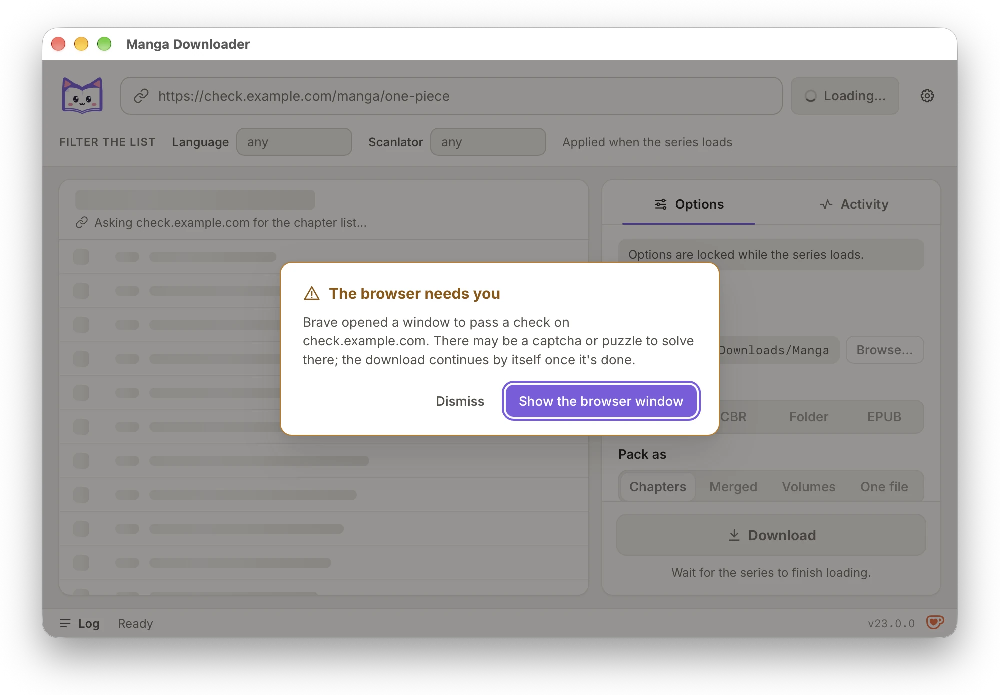
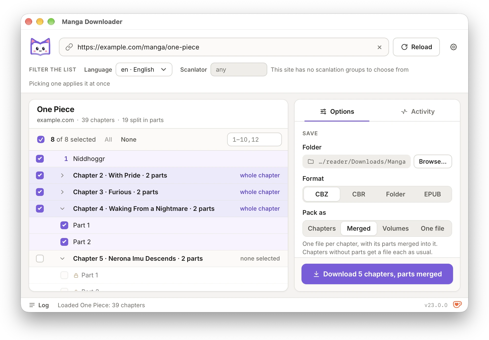
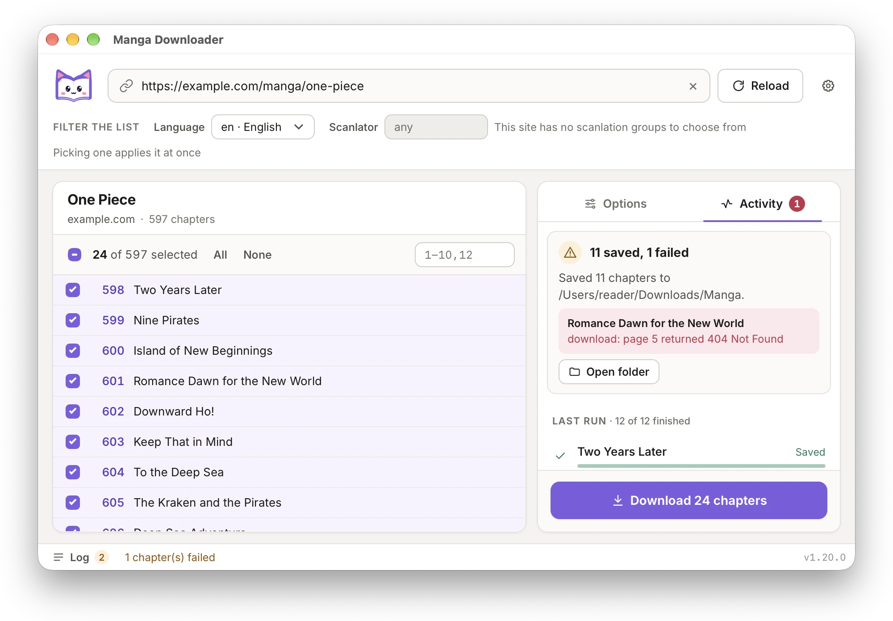
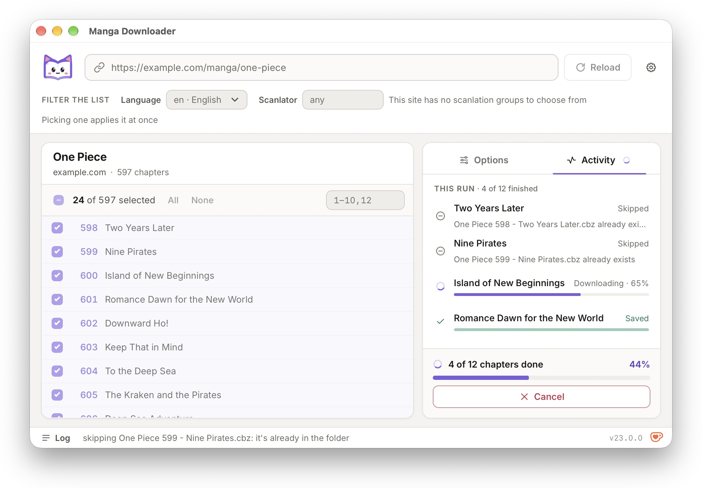

# Desktop app guide

For installing the app see the [README](../README.md#desktop-app).

<picture>
  <source media="(prefers-color-scheme: dark)" srcset="../assets/screenshots/01-start-dark.webp">
  
</picture>

The app opens on a simple start screen: the logo, the URL box with its *Paste*
button, *Load* and *Settings*. *Settings* → *Start screen* → *Open with the
simple view* turns it off, so the app opens on the full window instead. Then
follow these steps:

1. **Paste the series' URL** into the box (or use its *Paste* button). The
   series loads on its own once you paste or stop typing; *Load* or Enter
   loads it at once. The window then turns into the full app, with the URL box
   at the top and the chapter list below it:

   <picture>
     <source media="(prefers-color-scheme: dark)" srcset="../assets/screenshots/02-loaded-dark.webp">
     
   </picture>

2. **Pick chapters** in the list. Type a range such as `1-10,12` and press
   Enter (or the + in the box), Shift+click to select a span, or use *All* and
   *None*. The arrow keys and Space work too. Locked chapters (paid or members-only) show
   a lock and can't be selected.
3. **Choose a language and a scanlation group** when the site offers them. The
   selectors tell you when a series has none, and picking one reloads the
   chapter list. Sites that support it also offer *All*.

   <picture>
     <source media="(prefers-color-scheme: dark)" srcset="../assets/screenshots/03-language-selector-dark.webp">
     
   </picture>

4. **Set the options** in the *Options* tab: where the files go, the format
   (CBZ, CBR, Folder or EPUB; EPUB adds a *Reading direction*), *Pack as* (a
   file per chapter, per volume, or one for everything), *Convert to JPEG* for
   AVIF and WebP pages, pages to skip, and *Skip existing files*. Under
   *Advanced* are the file name template and *Show the browser window*, which
   you rarely need: a site that needs the window opens it by itself. Packing by
   volume adds a *Volumes* box above the chapter list. It starts empty, which
   packs the site's volumes; a line under it offers them as chapter ranges when
   they can be written that way. The list is grouped by volume.

   <picture>
     <source media="(prefers-color-scheme: dark)" srcset="../assets/screenshots/06-options-dark.webp">
     
   </picture>

   When a site needs you at its browser window, an alert says so, with *Show the
   browser window* to bring it to the front and *Dismiss* to hide the alert.

   <picture>
     <source media="(prefers-color-scheme: dark)" srcset="../assets/screenshots/09-browser-alert-dark.webp">
     
   </picture>

   <picture>
     <source media="(prefers-color-scheme: dark)" srcset="../assets/screenshots/07-volumes-dark.webp">
     
   </picture>

   *Pack as → Merged* packs a chapter's parts (19-① and 19-②) into one file named
   after the chapter, and leaves the chapters without parts as one file each.

   <picture>
     <source media="(prefers-color-scheme: dark)" srcset="../assets/screenshots/08-parts-dark.webp">
     
   </picture>

5. **Press Download.** The *Activity* tab shows each chapter as it's fetched and
   packed. *Cancel* lets the chapters already downloading finish, and starts no
   new ones. A log is one click away in the status bar.

   <picture>
     <source media="(prefers-color-scheme: dark)" srcset="../assets/screenshots/04-downloading-dark.webp">
     
   </picture>

6. **When it's done**, the summary shows what was downloaded. Press
   *Open folder* to go straight to the files.

   <picture>
     <source media="(prefers-color-scheme: dark)" srcset="../assets/screenshots/05-done-dark.webp">
     
   </picture>

   If a chapter fails, the summary names it and says why; the other chapters
   are still saved.

   <picture>
     <source media="(prefers-color-scheme: dark)" srcset="../assets/screenshots/11-failed-dark.webp">
     
   </picture>

   With *Skip existing files*, a chapter whose file is already in the folder is
   left out before anything is fetched: it shows as skipped in the Activity tab,
   and the summary says how many were there.

   <picture>
     <source media="(prefers-color-scheme: dark)" srcset="../assets/screenshots/14-skip-existing-dark.webp">
     
   </picture>

The app saves your options to `gui.json` in the `manga-downloader` folder of
your user config folder (the same place as the Manga Plus secret, see the
[command line guide](cli.md#environment-variables)), so they're still there
the next time you open it. Files go to your Downloads folder (or your home
folder, if there isn't one) unless you choose another folder.

The app uses the command line's defaults for concurrency and retries.
Sites whose image servers limit the request rate get lower limits
automatically, in both the app and the command line.

## Settings and the update check

When a newer release is out, a yellow *!* next to the version in the status bar
links to it. On the Windows installer's copy, the Linux install script's copy and
a macOS copy you can write to, it opens a dialog that updates the app in one
click, after checking the download against the release's checksums. While the
app's Homebrew cask is installed it keeps the link instead, since `brew upgrade`
updates that copy.

<picture>
  <source media="(prefers-color-scheme: dark)" srcset="../assets/screenshots/10-update-dark.webp">
  
</picture>

The gear icon (below the URL box on the start screen, in the header of the full app) or Ctrl+, / ⌘, opens Settings, where you pick the app's language (English, Español, Català or 日本語) and whether the app opens with the simple start screen. The same panel turns the update check on or off. The check asks our update server for the latest release, sending the app, its version, your OS and architecture, and the app's language (with your system's language when the app follows the system). The command line sends your system's language too. If our server doesn't answer, the app asks GitHub directly instead. The server runs on Cloudflare, which sees the IP address like any web host; only a hash of it, salted with a key deleted daily, is kept, to count daily users.

<picture>
  <source media="(prefers-color-scheme: dark)" srcset="../assets/screenshots/13-settings-dark.webp">
  
</picture>
