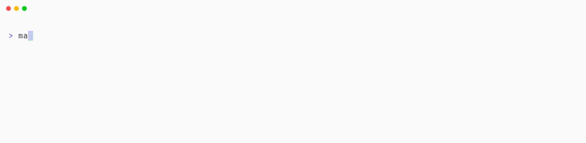

# Command line guide

Every flag and behaviour of `manga-downloader`. For installing it see the [README](../README.md#command-line).

~~~bash
manga-downloader [flags] [url] [chapters]
~~~

- `url` is the manga's **index page**, the page that lists all its chapters.
  The URL of a single chapter works too: it resolves to the whole series.
- `chapters` is a comma-separated list of numbers and ranges, such as
  `1,3,5-10`. If you leave it out, the tool asks whether to download every
  chapter. The answer defaults to "no". Write `all` instead to download every
  chapter without the question, as cron jobs and Docker runs without a
  terminal need.
  Chapters the site marks as locked (coins, early access or members-only) are skipped,
  with a line saying which.

Arguments aren't positional, so `manga-downloader 1-50 [url]` works too.

Leave the range out and it asks before downloading the whole series:

<picture>
  <source media="(prefers-color-scheme: dark)" srcset="../assets/demos/prompt.gif">
  
</picture>

## Language and scanlation group

Some sites, such as MangaDex, list each chapter once per language. Use
`--language` to download only one of them:

~~~bash
manga-downloader --language es https://mangadex.org/title/a1c7c817-4e59-43b7-9365-09675a149a6f 1-10
~~~

On sites that list several languages, `--language all` downloads every one of them.

Some sites host several scanlation groups' versions of the same chapter. By
default every release is kept, and each one is told apart by its group: the
chapter list shows the group, and `{{.Group}}` in `--filename-template` names
it. Use `--scanlator <name>` to keep only one group's releases (the name is
matched ignoring case; an unknown one lists the groups the series has), or
`--scanlator all` for every group, which is the same as the default. Releases
that name no group are left out whenever a group is selected.

The default file name adds the release's group in brackets when it names one
(`One Piece 5 - Chapter 5 [Alpha]`), so each release keeps its own file. A
template without `{{.Group}}` only tells the releases apart by a version
suffix (`v2`, `v3`…), in no particular group order.

<picture>
  <source media="(prefers-color-scheme: dark)" srcset="../assets/demos/groups.gif">
  
</picture>

## Bundling and output format

~~~bash
# all chapters in a single CBZ, one folder per chapter inside it
manga-downloader --bundle [url] 1-8

# CBR archives instead of CBZ files, for readers that prefer RAR
manga-downloader --format cbr [url] 1-8

# plain image folders instead of CBZ files
manga-downloader --format raw [url] 1-8

# EPUB e-books, read left to right (western comics)
manga-downloader --format epub --reading-direction ltr [url] 1-8
~~~

<picture>
  <source media="(prefers-color-scheme: dark)" srcset="../assets/demos/bundle.gif">
  
</picture>

## Volumes

`--volumes` packs one file per volume. `auto` uses the volumes the site files
chapters under (not every site lists them); otherwise give the chapters of each
volume, separated by slashes, in the chapter range syntax:

~~~bash
manga-downloader --volumes 1-7/8-16 [url] 1-20
~~~

That writes `Series Vol. 01 (1-7).cbz` and `Series Vol. 02 (8-16).cbz` (`.cbr`
with `--format cbr`, `.epub` with `--format epub`), with a folder per chapter
inside. The parentheses list the chapters in the file as runs of the site's list
(`(1-10,13-28)` when 11 and 12 aren't in the volume, `(1,3)` when 2 failed), so
two groupings of one volume number don't collide. Chapters 17 to 20, outside
every volume, get one file each. The chapters argument still picks what's
downloaded: a volume packs the chapters of it you asked for. A group can give
its volume number with `N:`, and the groups after it count on from there:

~~~bash
manga-downloader --volumes 16:112-114/115-118 [url] 112-118
~~~

That's volumes 16 and 17. An empty group also skips a number (`1-7//20-30` has
no volume 2), and `--volumes` can't be combined with `--bundle`.

`parts` packs the parts of a chapter (the releases sharing its number, group and language,
like 19-① and 19-②) into one file named after the chapter, with a folder per part:

~~~bash
manga-downloader --volumes parts [url] 18-19
~~~

That writes `Series 19 - Chapter 19 [Group].cbz` next to the chapters without parts.

<picture>
  <source media="(prefers-color-scheme: dark)" srcset="../assets/demos/volumes.gif">
  
</picture>

## Image conversion

Most e-readers can't display AVIF, so a chapter with AVIF pages looks empty on
the device even though the download succeeded. **AVIF pages are converted to
JPEG by default.** WebP renders fine in phone apps but is unreliable on e-ink,
so converting it is opt-in:

~~~bash
manga-downloader --convert-images avif,webp [url] 1-10   # strict e-ink setup
manga-downloader --convert-images none [url] 1-10        # keep pages untouched
~~~

JPEG, PNG and GIF pages are never re-encoded by `--convert-images`. If a page
fails to convert, it's kept as it was and a warning is shown, so the rest of the
chapter isn't lost.

`--compress` is for file size instead: it re-encodes JPEG, PNG, WebP and AVIF
pages to JPEG, but only when the JPEG comes out smaller, and keeps the original
otherwise (flat artwork is often smaller as a PNG). GIF pages are left alone,
since re-encoding one keeps only its first frame. It works with any
`--convert-images` value, and doesn't resize pages. A format `--convert-images`
asks for is always converted, whatever the size.

`--jpeg-quality` (1-100, default 90) sets the quality of every page written as
JPEG, by `--convert-images` and `--compress` alike. JPEG pages only shrink
noticeably at a lower quality, so `--compress --jpeg-quality 70` is the setting
to try on a JPEG-heavy site; at 90 most of them come out bigger and are kept.

EPUB is the exception, since readers can't show AVIF at all: AVIF pages are
always converted for it, even with `--convert-images none`. A page an EPUB can't
show (anything but JPEG, PNG, GIF or WebP, such as an AVIF that failed to convert)
is left out with a warning instead of being kept.

> [!NOTE]
> The AVIF decoder is embedded as WebAssembly, so you don't need to install any
> system library. It's slower on the 32-bit builds (`linux-386` and
> `windows-32bit-legacy`), so use `--convert-images none` there if speed
> matters.

The desktop app offers the same choices: the *AVIF* and *WebP* checkboxes, a
*Compress pages* switch, and a *JPEG quality* field under Advanced.
With EPUB, AVIF is always converted, so its box is ticked and can't be changed.

## Skipping pages

Scanlation groups often reserve a page or two of every chapter for their own
credits or ads. `--skip-pages` drops them, using the same range syntax as the
chapter argument, applied to each chapter's pages:

~~~bash
manga-downloader --skip-pages 2 [url] 1100-1110       # just the credits page
manga-downloader --skip-pages 2,5-7 [url] 1100-1110   # several at once
~~~

Pages count from 1, and **negative positions count backwards from the end of
the chapter**: `-1` is its last page, `-3--1` the last three. They're resolved
per chapter, so `-1` means each chapter's own last page however long it is:

~~~bash
manga-downloader --skip-pages 2,-1 [url] 1100-1110    # one at each end
~~~

The pages are dropped **before** they're downloaded, so they cost no time or
bandwidth, and a page that's broken on the site's end can't fail the chapter
around it — which is the only way to download a chapter whose page 404s.

The archive is still numbered `000`, `001`, … in order, with no holes left by
the skipped pages. A position the chapter doesn't have is ignored.

> [!TIP]
> Both `--skip-pages -1` and `--skip-pages=-1` work: the value right after the
> flag is taken verbatim, dash and all. Use the `=` form if a shell or a
> wrapper script trips on the leading dash.

## File names

Use `--filename-template` to change file names. It takes a
[Go text/template][go template] string, and the default is:

~~~
{{.Series}} {{.Number}} - {{.Title}}{{if .Group}} [{{.Group}}]{{end}}{{if gt .Version 1}} v{{.Version}}{{end}}
~~~

`{{.Version}}` is a counter that's added when two files would have the same
name, and `{{.Volume}}` is the volume number (0 when the site doesn't say);
`{{printf "%02d" .Volume}}` pads it. A template that leaves `{{.Version}}` out
still gets the suffix when names collide: the second file is `X v2`, the third
`X v3`, and so on, so `{{.Series}} {{.Number}} [{{.Group}}]` never overwrites a
release.

Volume files (`--volumes`) get their own default name while the template is
left as is:

~~~
{{.Series}} Vol. {{printf "%02d" .Volume}} ({{.Number}}){{if .Group}} [{{.Group}}]{{end}}{{if gt .Version 1}} v{{.Version}}{{end}}
~~~

A custom template names them too, with `{{.Number}}` being the runs the volume
holds (`1-7`, or `1-10,13-28` when it has a gap) and `{{.Title}}` `Vol. 01`.

`{{.Title}}` is the chapter's label: its title, or `Chapter 12` when the site
gives none. `{{.SiteTitle}}` is the site's own title alone, empty when it gives
none and for a volume or a bundle.

`pad` zero-pads a number's whole part and keeps its decimals: `{{pad .Number 4}}`
is `0005` for chapter 5 and `0010.5` for 10.5. MangaDex chapters used to be
named with a padded label; this template names per-chapter MangaDex downloads
that way again (with `Capítulo` in place of `Chapter` for InManga), except that
decimal chapters keep their real number (`0010.5`). Like any custom template,
it also names `--volumes` files, and in the app it applies to every site:

~~~
{{.Series}} {{.Number}} - Chapter {{pad .Number 4}}{{if .SiteTitle}} {{.SiteTitle}}{{end}}{{if .Group}} [{{.Group}}]{{end}}{{if gt .Version 1}} v{{.Version}}{{end}}
~~~

`{{.Group}}` is the scanlation group that made the release (empty when the site
doesn't say). A volume or a bundle gets its group only when all of its chapters
were made by the same one, so mixed groups leave it empty.

## Skipping existing files

`--skip-existing` leaves out a chapter, volume or bundle whose file is already
in the output folder, before its pages are fetched. It checks the name the
first try gets (without the ` v2` suffix), usually costs no request, and never
deletes or overwrites anything: to download a broken or partial file again,
delete it first. It assumes the template tells chapters apart: a template
that names only the series would skip every chapter after the first. To keep a
folder up to date, run it from cron:

~~~bash
0 6 * * * manga-downloader --skip-existing -o ~/Manga/Series "<series url>" all
~~~

<picture>
  <source media="(prefers-color-scheme: dark)" srcset="../assets/demos/skip-existing.gif">
  
</picture>

## Environment variables

| Variable           | Description                                    |
| ------------------ | ---------------------------------------------- |
| `MANGAPLUS_SECRET` | Anonymous device secret to use for Manga Plus |

**Manga Plus** answers the complete chapter list only to an app client, which
authenticates with an anonymous device secret. manga-downloader registers one
on first use and caches it in `manga-downloader/mangaplus-secret` inside your
user config folder (`$XDG_CONFIG_HOME` or `~/.config` on Linux,
`~/Library/Application Support` on macOS, `%AppData%` on Windows): no account is
ever needed. Secrets are 32 lowercase hexadecimal characters, and anything that
isn't one is treated as absent — so exporting a malformed `MANGAPLUS_SECRET`,
or deleting the cached file, makes the next run register a fresh device, as
does a cached secret the API stops accepting. Export a valid
`MANGAPLUS_SECRET` to reuse a secret registered elsewhere, such as the one of a
device with your Manga Plus subscription.

In **Docker**, the cached secret lives inside the container and is lost with
it, so every run registers a new device. To keep one, either pass it with
`-e MANGAPLUS_SECRET=...`, or mount your own config folder so the container
shares the secret of your local install (create the folder first, or Docker
creates it owned by root):

~~~bash
mkdir -p ~/.config/manga-downloader
docker run --rm -it -v "$PWD:/downloads" \
    -v ~/.config/manga-downloader:/home/manga/.config/manga-downloader \
    elboletaire/manga-downloader [url] [chapters]
~~~

Manga Plus also publishes **one edition per language**, and their chapter
lists differ: some list the whole series, others only a handful of chapters.
A URL points at one edition, and `--language` downloads another one instead
(`--language en` on a Spanish URL downloads the English edition).

## Options

| Flag                  | Short | Description                                                    | Default        |
| --------------------- | ----- | -------------------------------------------------------------- | -------------- |
| `--output-dir`        | `-o`  | Folder to write the downloaded files to                        | current folder |
| `--bundle`            | `-b`  | Bundle all chapters into a single file                         | off            |
| `--volumes`           |       | One file per volume: `auto`, `parts`, `1-7/8-16`               | off            |
| `--format`            | `-f`  | Output format: `cbz`, `cbr`, `raw` or `epub`                   | `cbz`          |
| `--reading-direction` |       | Page turn direction for EPUB: `rtl` (manga) or `ltr`           | `rtl`          |
| `--filename-template` | `-t`  | Template for the file names                                    | see above      |
| `--language`          | `-l`  | Only download the specified language                           | site default   |
| `--scanlator`         | `-s`  | Only download the specified scanlation group (or `all`)        | `all`          |
| `--convert-images`    |       | Formats to JPEG: `avif`, `webp` or `none`                      | `avif`         |
| `--compress`          |       | Re-encode pages to JPEG when that's smaller (not GIF)          | off            |
| `--jpeg-quality`      |       | JPEG quality of re-encoded pages (1-100); lower shrinks JPEG pages more | `90`           |
| `--skip-pages`        |       | Pages to exclude from every chapter (`-1` is the last)         | none           |
| `--skip-existing`     |       | Skip chapters, volumes or bundles already in the output folder | off            |
| `--concurrency`       | `-c`  | Number of chapters downloaded at once (max 5)                  | 5              |
| `--concurrency-pages` | `-C`  | Number of pages downloaded at once per chapter (max 10)        | 10             |
| `--retry`             | `-r`  | Retries per failed page (max 3, `0` disables retrying)         | 1              |
| `--browser-visible`   |       | Always show the browser window (rarely needed)                 | off            |
| `--version`           | `-v`  | Show version information                                       |                |

Run `manga-downloader help` to list them in your terminal. `version` (and `--version`) checks for a newer release too; set `MANGA_DOWNLOADER_NO_UPDATE_CHECK=1` to skip it.

Some sites cap the concurrency lower, because their image servers refuse
requests that come too fast; a lower value still applies there. Pages refused
for coming too fast (a 429) are retried after the wait the server asks for, up
to a minute.

[go template]: https://pkg.go.dev/text/template
